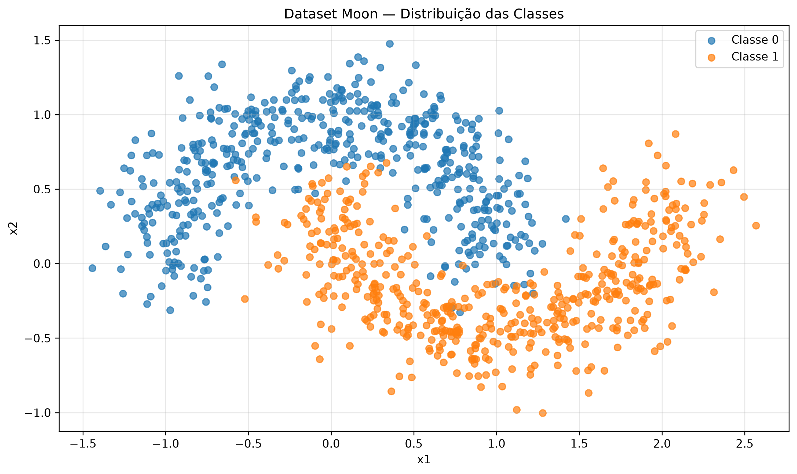
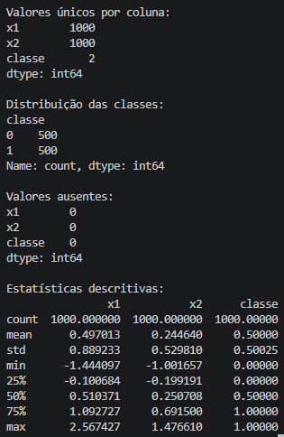
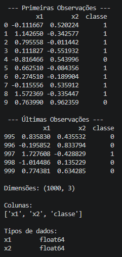

# 🌙 Machine Learning - Dataset Moon


Projeto de estudo de **Machine Learning** utilizando o Dataset Moon, com foco na geração de dados sintéticos, análise exploratória de dados (EDA) e visualização da distribuição de classes para problemas de classificação binária não linear.

A estrutura de um conjunto de dados sintético, compreender suas características e visualizar a distribuição das classes antes de avançar para o treinamento de modelos de Machine Learning.

## 📚 Conteúdo estudado

- Geração de dados sintéticos com `make_moons()`, do Scikit-learn.
- Estrutura de matrizes e vetores NumPy.
- Identificação e nomeação de características.
- Criação e inspeção de DataFrames com Pandas.
- Análise Exploratória de Dados (EDA).
- Gráficos de dispersão com Matplotlib.
- Visualização das classes `0` e `1`.
- Modularizado por funções com Python

## 🧪 Dataset Moon

A função `make_moons()` gera duas classes de dados em formato de meias-luas entrelaçadas, permitindo estudar problemas de classificação em que a fronteira de decisão não é linear.

## 📊 Análise Exploratória de Dados (EDA)

A análise exploratória permite compreender a estrutura e a distribuição dos dados antes da aplicação dos algoritmos de Machine Learning.

### Distribuição das classes



### Inspeção do DataFrame



### Análise dos dados



## 🛠️ Tecnologias utilizadas

- **Python:** linguagem de programação.
- **Scikit-learn:** geração do conjunto de dados sintético.
- **NumPy:** manipulação de matrizes e vetores.
- **Pandas:** organização e inspeção dos dados.
- **Matplotlib:** criação de gráficos e visualizações.
- **Git e GitHub:** versionamento e documentação do projeto.

## 📁 Estrutura do projeto

```text
ml_mlops/
├── eda/
│   ├── dataset_moon.py
│   └── analytics_dataset_moon.py
├── docs/
│   └── images/
│       ├── scatter_dataset_moon.png
│       ├── eda_2_moon.png
│       └── EDA_moon.png
├── .gitignore
└── README.md
```

*Estrutura ilustrativa, considerando os scripts e arquivos de imagem utilizados até esta etapa.*

## ▶️ Como executar

### 1. Instale as dependências

Com o ambiente virtual ativado:

```bash
pip install scikit-learn pandas matplotlib
```

### 2. Execute os scripts

A partir da raiz do projeto:

```bash
python eda/dataset_moon.py
python eda/analytics_dataset_moon.py
```

**Observação:** o segundo script importa o DataFrame do primeiro. Por isso, o módulo deve estar organizado conforme os imports utilizados no projeto.

## 📖 Documentação oficial

- [Scikit-learn — `make_moons()`](https://scikit-learn.org/stable/modules/generated/sklearn.datasets.make_moons.html)
- [Pandas — documentação oficial](https://pandas.pydata.org/docs/)
- [Matplotlib — documentação oficial](https://matplotlib.org/stable/)


**Estudos de Machine Learning**, desenvolvido para consolidar conceitos de geração de dados, análise exploratória e classificação binária.