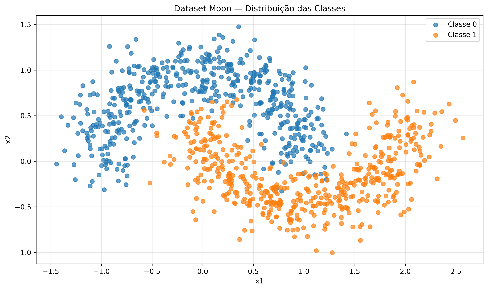

# 🌙 Machine Learning - Dataset Moon

Estudo de **Machine Learning com redes neurais artificiais**, desenvolvido a partir do conjunto de dados sintético *Dataset Moon*, com foco em classificação binária de padrões não lineares.

O estudo abrange todo o fluxo de desenvolvimento de um modelo de aprendizagem de máquina: geração e exploração dos dados, pré-processamento, construção da arquitetura neural, compilação, treinamento e avaliação.

Também são realizados experimentos progressivos com técnicas de regularização, análise de overfitting, capacidade de generalização e ajustes do limiar de classificação (*threshold*), permitindo comparar diferentes configurações e compreender seus impactos no desempenho do modelo.

O objetivo é investigar como uma rede neural aprende padrões não lineares, identificar fatores que influenciam sua capacidade de generalização e avaliar estratégias para aprimorar a classificação.

---

## 🧪 Dataset Moon

O *Dataset Moon* é um conjunto de dados sintético gerado pela função `make_moons()`, disponibilizada pelo Scikit-learn.

Sua estrutura apresenta duas classes distribuídas em formatos de meias-luas entrelaçadas, criando um problema de classificação binária cuja separação exige uma fronteira de decisão não linear.

**Configuração utilizada:**

| Parâmetro | Valor |
|---|---:|
| Número de amostras | 1.000 |
| Número de características | 2 |
| Número de classes | 2 |
| Ruído (`noise`) | 0.20 |
| Semente (`random_state`) | 42 |

Essa característica torna o conjunto adequado para investigar como redes neurais aprendem relações complexas entre variáveis e constroem fronteiras de decisão.

## 📊 Análise Exploratória de Dados (EDA)

A análise exploratória de dados permite compreender a estrutura, a distribuição e as características do conjunto de dados antes da construção do modelo.

Nesta etapa, são realizadas inspeções com Pandas e visualizações com Matplotlib, verificando as características das variáveis, a distribuição das classes e a integridade dos dados.

### Distribuição das classes

Visualização das duas classes e de seus respectivos padrões não lineares.



## 🧠 Desenvolvimento da Rede Neural

Após a exploração dos dados, inicia-se a construção de uma rede neural artificial utilizando TensorFlow e Keras.

O desenvolvimento contempla:

- Separação dos dados em conjuntos de treinamento e teste.
- Padronização das variáveis de entrada com StandardScaler.
- Definição da arquitetura da rede neural.
- Compilação com otimizador Adam e função de perda Binary Crossentropy.
- Treinamento com validação e acompanhamento das métricas.

*A proposta é construir uma arquitetura capaz de aprender a distribuição não linear das duas classes.*

## ⚙️ Treinamento e Regularização

Com a arquitetura inicial definida, são realizados experimentos para investigar como diferentes estratégias de treinamento influenciam o aprendizado e a generalização.

As configurações são desenvolvidas progressivamente:

- **Modelo base:** referência inicial para comparação.
- **Dropout:** redução da dependência excessiva entre neurônios.
- **Batch Normalization:** normalização das ativações durante o treinamento.
- **L2 Regularization:** penalização de pesos elevados para controlar a complexidade do modelo.

Os resultados são analisados por meio das curvas de treinamento e validação, permitindo observar o comportamento da função de perda, da acurácia e os possíveis sinais de overfitting.

## 🎯 Avaliação e Limiar de Classificação

A avaliação considera métricas de desempenho e visualizações que permitem investigar a qualidade das previsões realizadas pela rede neural.

São utilizadas métricas como:

- **Accuracy:** proporção de classificações corretas.
- **AUC:** capacidade de distinguir as duas classes.
- **Precision:** proporção de previsões positivas que realmente são positivas.
- **Recall:** proporção de exemplos positivos corretamente identificados.
- **F1-Score:** equilíbrio entre precisão e recall.

Também são investigados diferentes valores de *threshold*, responsáveis por converter as probabilidades previstas pelo modelo em classes.

Essa etapa permite compreender como a alteração do limiar influencia as classificações e a fronteira de decisão, buscando um equilíbrio adequado entre os erros de cada classe.

## 📈 Visualizações e Comparação dos Resultados

As visualizações permitem interpretar o comportamento da rede neural e comparar os resultados obtidos durante os experimentos.

Entre as análises desenvolvidas estão:

- Fronteira de decisão e distribuição das classes.
- Distribuição das probabilidades previstas.
- Matriz de confusão.
- Curvas de perda e acurácia.
- Análise de overfitting e generalização.
- Comparação das métricas entre as configurações de regularização.

O objetivo é relacionar os resultados quantitativos com o comportamento visual dos modelos, identificando quais estratégias apresentam melhores resultados para o problema proposto.

## 🛠️ Tecnologias utilizadas

| Tecnologia | Aplicação |
|---|---|
| **Python 3.12+** | Linguagem de programação |
| **Scikit-learn** | Geração de dados, pré-processamento e divisão dos conjuntos |
| **TensorFlow / Keras** | Construção, treinamento e avaliação das redes neurais |
| **NumPy** | Manipulação de matrizes e operações numéricas |
| **Pandas** | Organização e análise dos dados |
| **Matplotlib** | Visualização gráfica dos resultados |
| **MkDocs Material** | Documentação técnica do estudo |

## 📁 Estrutura do projeto

```text
ml_mlops/
├── data/
├── docs/
│     └── images/
├── eda/
│   ├── dataset_moon.py
│   └── analytics_dataset_moon.py
│
├── src/
│   └── moon/
│       ├── a_data.py
│       ├── b_model.py
│       ├── c_compile.py
│       ├── d_train.py
│       ├── e_evaluate.py
│       ├── plots.py
│       └── regularization/
|                   └── regulate.py                
|                   └── plots_comparison.py
|                   └── plots_threshold.py
│
│   
│
├── .gitignore
├── main.py
├── mkdocs.yml
└── README.md
```

*Estrutura resumida para representar a organização dos principais módulos e diretórios do projeto.*

## ▶️ Como executar o projeto

### 1. Clone o repositório

```bash
git clone https://github.com/userdanixdev/ml_mlops.git
```

### 2. Acesse o diretório

```bash
cd ml_mlops
```

### 3. Crie e ative o ambiente virtual

**Windows (PowerShell):**

```powershell
python -m venv .venv
.venv\Scripts\Activate.ps1
```

**Windows (Git Bash):**

```bash
python -m venv .venv
source .venv/Scripts/activate
```

### 4. Instale as dependências

```bash
pip install numpy pandas scikit-learn matplotlib tensorflow
```

### 5. Execute o projeto

Os experimentos podem ser executados individualmente a partir da raiz do repositório, utilizando os respectivos scripts disponíveis nos diretórios `eda/` e `src/moon/`.

Consulte a documentação do projeto para conhecer a sequência de execução, os módulos e as configurações utilizadas em cada experimento.

## 📚 10. Referências e documentação oficial

- [Scikit-learn — make_moons()](https://scikit-learn.org/stable/modules/generated/sklearn.datasets.make_moons.html)
- [TensorFlow — Documentação oficial](https://www.tensorflow.org/)
- [Keras — Documentação oficial](https://keras.io/)
- [NumPy — Documentação oficial](https://numpy.org/doc/)
- [Pandas — Documentação oficial](https://pandas.pydata.org/docs/)
- [Matplotlib — Documentação oficial](https://matplotlib.org/stable/)

---

**Machine Learning — Dataset Moon**

Estudo desenvolvido para explorar, implementar e avaliar redes neurais artificiais em problemas de classificação binária não linear, consolidando conceitos de análise de dados, aprendizagem, regularização e generalização.