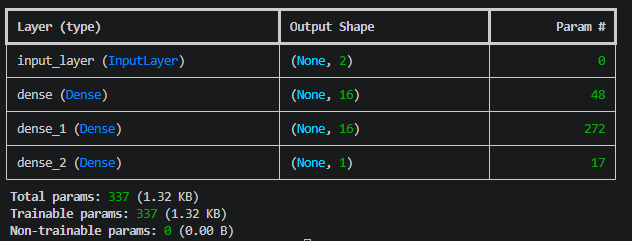
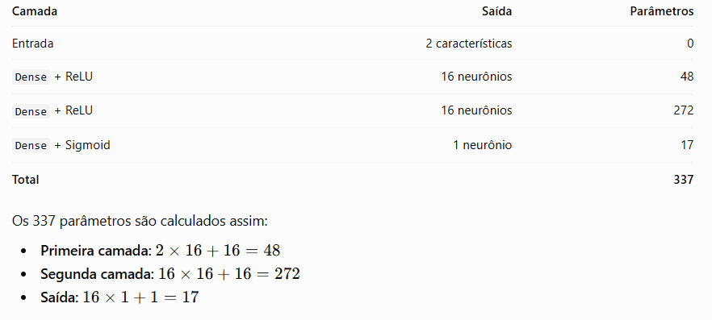
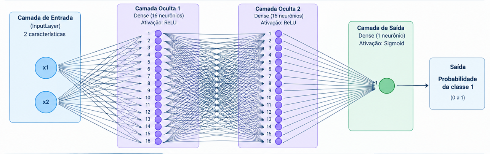

# Arquitetura MLP - Dataset Moon com Keras

O método `model.summary()` é utilizado no Keras para exibir um resumo da arquitetura de uma rede neural. Ele apresenta as camadas que compõem o modelo, o formato das saídas e a quantidade de parâmetros associados a cada camada.

No estudo com **Dataset Moon**, utilizamos esse recurso para verificar se a arquitetura da nossa **MLP (Multilayer Perceptron)** foi construída corretamente antes da compilação e do treinamento.

## 1. Summary:

A rede neural possui as seguintes camadas:

| Camada | Função | Saída | Parâmetros |
|---|---|---|---:|
| `InputLayer` | Recebe as características de entrada | `(None, 2)` | 0 |
| `Dense` | Primeira camada oculta, com ativação ReLU | `(None, 16)` | 48 |
| `Dense` | Segunda camada oculta, com ativação ReLU | `(None, 16)` | 272 |
| `Dense` | Camada de saída, com ativação Sigmoid | `(None, 1)` | 17 |
| **Total** | | | **337** |

## 2. Significado dos campos

### Output Shape

Representa o formato dos dados produzidos por cada camada.

- `(None, 2)`: a entrada possui duas características, `x1` e `x2`.
- `(None, 16)`: a camada produz 16 valores, um para cada neurônio.
- `(None, 1)`: a saída produz um único valor, utilizado para estimar a probabilidade da classe 1.

O valor `None` representa a quantidade de amostras processadas em cada lote (*batch*), que pode variar.

### Param #

Indica a quantidade de parâmetros associados a cada camada, incluindo pesos e vieses (*biases*).

Na arquitetura atual:

- **Primeira camada:** `(2 × 16) + 16 = 48` parâmetros.
- **Segunda camada:** `(16 × 16) + 16 = 272` parâmetros.
- **Camada de saída:** `(16 × 1) + 1 = 17` parâmetros.

> A quantidade de pesos depende das conexões entre os neurônios. Os vieses são parâmetros adicionais que permitem ajustar a resposta de cada neurônio.

### Total params

Representa a quantidade total de parâmetros do modelo. Nossa MLP possui **337 parâmetros**, distribuídos entre as três camadas Dense.

### Trainable params

Indica quantos parâmetros podem ser ajustados durante o treinamento. Neste momento, todos os 337 parâmetros são treináveis.

### Non-trainable params

Representa parâmetros que não são atualizados durante o treinamento convencional. Atualmente, o valor é zero, pois nossa arquitetura ainda não possui componentes que introduzam parâmetros não treináveis.

## 3. Funções de ativação

A rede utiliza duas funções de ativação:

- **ReLU:** aplicada às camadas ocultas, introduz não linearidade e permite que a rede aprenda relações mais complexas entre as características.
- **Sigmoid:** aplicada à camada de saída, transforma o resultado em um valor entre 0 e 1, adequado à classificação binária.

O **MLP** de referência com duas camadas ocultas de 16 neurônios cada e uma camada de saída com um neurônio.

O modelo ainda não foi compilado nem treinado. Portanto, seus pesos ainda não foram ajustados para aprender os padrões do Dataset Moon.

Essa arquitetura servirá como referência para os próximos experimentos, nos quais adicionaremos progressivamente as técnicas de regularização e estabilização:

1. Regularização L2.
2. Batch Normalization.
3. Dropout.

> Dessa forma, poderemos comparar o comportamento da rede antes e depois da inclusão de cada técnica.
