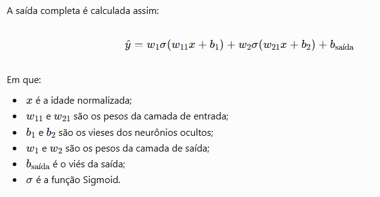
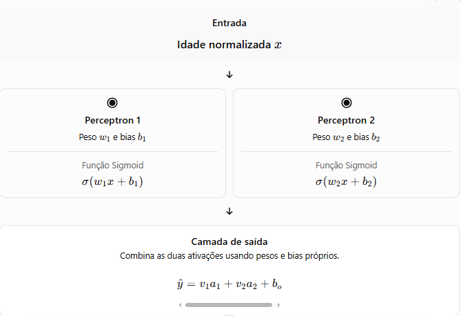
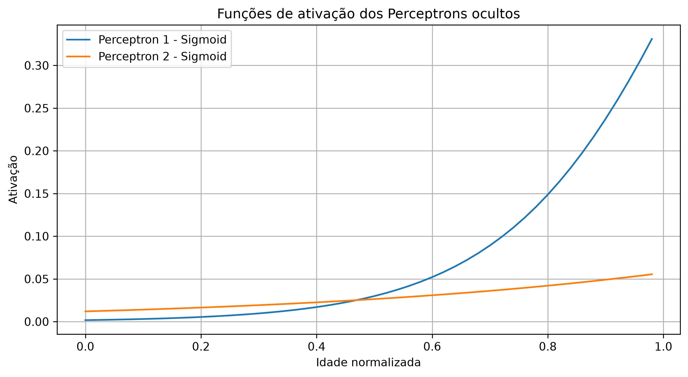
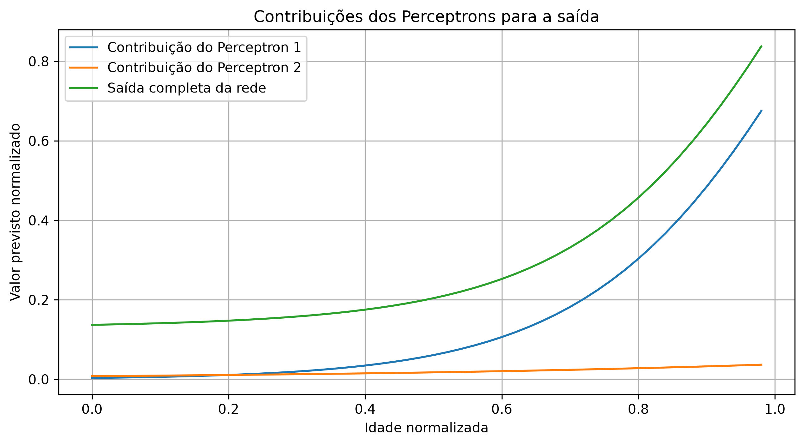

# Avaliações do modelo:

A rede possui dois perceptrons ocultos. Cada um realiza três operações:

1. Calcula uma combinação linear da entrada, usando seu peso e viés.
2. Aplica a função Sigmoid ao resultado.
3. Multiplica a ativação pelo peso correspondente na camada de saída.



### Como funciona mesmo?

Cada perceptron da camada hidden (oculta) transforma a idade normalizada em um sinal que será utilizado pela camada de saída para estimar o valor do seguro. E que no caso são 2 perceptrons.



Cada perceptron recebe o mesmo valor de entrada mas possuem seus próprios pesos e bias aprendidos durante o treinamento. Por isso eles podem responder de maneiras diferentes à idade.

### Então quando de fato a ativação ocorre?

Ocorre aqui:
```python
y1 = x_range * pesos_entrada[0, 0] + bias_entrada[0]
sigmoid_1 = torch.sigmoid(y1)
```
O cálculo acontece em duas etapas:

1. **Combinação Linear** : Onde o perceptron multiplica a entrada pelo peso e soma o bias. O resultado **y1* representa o valor antes da ativação.
2. **Função de ativação:** A função *Sigmoid* transforma esse resultado em um número entre 0 e 1.

**Em resumo:** A ativação é a resposta de cada neurônio após aplicar sua função de ativação à combinação ponderada da entrada. Ela não é a previsão final: é um componente que a rede aprende a combinar para produzir essa previsão.



Se uma curva aumenta com a idade, significa que a ativação daquele neurônio aumenta nessa faixa de entrada. Se diminui, significa que sua ativação diminui. Isso depende dos pesos e dos bias aprendidos.

### E como isso influencia o valor previsto do seguro?

Cada ativação é multiplicada pelo peso que conecta o neurônio à saída. Portanto:

* Uma ativação alta com peso positivo aumenta a contribuição daquele neurônio.
* Uma ativação alta com peso negativo diminui a contribuição.
* Uma ativação baixa reduz a magnitude da contribuição, seja o peso positivo ou negativo.

A saída final soma as duas contribuições e o bias da camada de saída. Ela ainda está na escala normalizada do alvo; para obter o valor monetário do seguro, você precisa aplicar a transformação inversa usada na normalização.

### Por que utilizar dois perceptrons?

Porque cada neurônio pode aprender uma resposta diferente à mesma entrada. A camada de saída combina essas respostas para representar uma relação potencialmente não linear entre idade e valor do seguro.

No caso, a rede possui:

* 1 variável de entrada: idade normalizada;
* 2 neurônios ocultos com Sigmoid;
* 1 neurônio de saída linear, adequado para regressão.



> **Observação importante** : As curvas dos perceptrons isolados mostram suas contribuições parciais. A previsão final também inclui o viés da camada de saída, por isso não é simplesmente a soma das duas curvas sem esse termo.

*Além disso, os gráficos mostram o comportamento aprendido pelo modelo ao longo de entradas entre 0 e 1. Ele não demonstra, sozinho, a qualidade das previsões: para isso, precisamos comparar os resultados com os valores reais dos seguros.*


