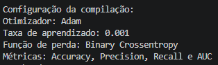

## Compilação do MLP com Keras

A etapa de compilação configura os principais componentes necessários para o treinamento da rede neural. No Keras, o método `model.compile()` define o otimizador, a função de perda (*loss*) e as métricas utilizadas para acompanhar o desempenho do modelo.

```python
model.compile(
    optimizer=keras.optimizers.Adam(learning_rate=1e-3),
    loss="binary_crossentropy",
    metrics=["accuracy"]
)
```

### 1. `optimizer`: Otimizador Adam

```python
optimizer=keras.optimizers.Adam(learning_rate=1e-3)
```

O otimizador é responsável por atualizar os pesos e os vieses da rede neural durante o treinamento, buscando minimizar a função de perda.

O **Adam (Adaptive Moment Estimation)** combina estimativas dos gradientes e de seus momentos para adaptar as atualizações dos parâmetros ao longo do treinamento.

O argumento `learning_rate=1e-3` define a taxa de aprendizado como `0.001`. Esse valor controla o tamanho das atualizações dos parâmetros a cada etapa de otimização.

Uma taxa muito alta pode dificultar a convergência, enquanto uma taxa muito baixa pode tornar o treinamento mais lento.

### 2. `loss`: Função de perda

```python
loss="binary_crossentropy"
```

A *Binary Crossentropy* é uma função de perda utilizada em problemas de classificação binária, como o Dataset Moon, que possui duas classes: `0` e `1`.

Ela mede a diferença entre os rótulos reais e as probabilidades previstas pelo modelo. Durante o treinamento, o otimizador procura minimizar esse valor.

**Importante:** essa configuração pressupõe que a camada de saída produza uma probabilidade entre `0` e `1`, normalmente utilizando a ativação `sigmoid`.

### 3. `metrics`: Métrica de avaliação

```python
metrics=["accuracy"]
```

O argumento `metrics` define quais métricas serão calculadas durante o treinamento e a avaliação do modelo.

Nesse caso, `accuracy` representa a **acurácia**, ou seja, a proporção de previsões classificadas corretamente em relação ao total de amostras avaliadas.

Por exemplo, se o modelo classificar corretamente 950 de 1.000 amostras, sua acurácia será de 95%.

Diferentemente da função de perda, que orienta a otimização dos parâmetros, a acurácia serve para acompanhar o desempenho da classificação.


| Componente | Função | Exemplos
|---|---| --- |
| `optimizer` | Atualiza os parâmetros da rede neural. Ajusta os pesos para minimizar a perda| Adam, SGD, MSprop
| `learning_rate` | Controla o tamanho das atualizações dos pesos. | 
| `loss` | Quantifica o erro das previsões em relação aos rótulos reais. | binary_crossentropy, MSE
| `metrics` | Define indicadores para acompanhar o desempenho do modelo. | accuracy, Precision, AUC

### Quais são as principais métricas que devemos considerar?

| Métrica | Função |
|---|---|
| `accuracy` | Proporção total de classificações corretas. |
| `precision` | Entre as previsões positivas, quantas são realmente positivas |
| `recall` | Entre os positivos reais, quantos o modelo identificou corretamente |
| `auc` | Capacidade de distinguir as classes considerando diferentes limiatres de classificação |

* Precisão Baixa: o modelo pode estar classificando muitos exemplos negativos como positivos.
* Recall Baixo: o modelo pode estar deixando de passar muitos exemplos positivos.
* AUC elevada: o modelo pode conseguir separar bem as classes ao variar o limiar de decisão.

Dessa forma também podemos definir no compilador mais métricas:

```python
model.compile(
    optimizer=keras.optimizers.Adam(learning_rate=1e-3),
    loss="binary_crossentropy",
    metrics=["accuracy",
             keras.metrics.Precision(name='precision'),
             keras.metrics.Recall(name='recall'),
             keras.metrics.AUC(name='auc')]
)
```


            
*A compilação não produz resultados de desempenho do modelo. Ela configura o processo de aprendizado e as métricas que serão calculadas. Os resultados numéricos aparecerão durante o treinamento e na avaliação.*

*Após a compilação, o modelo estará configurado para ser treinado com `model.fit()`, que executará o processo de aprendizado a partir dos dados fornecidos.*


