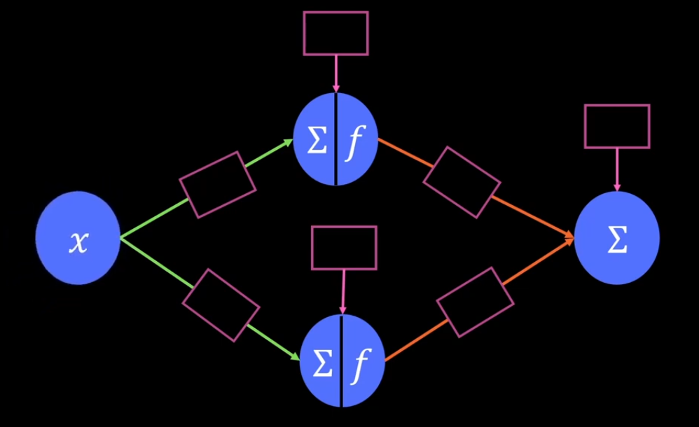
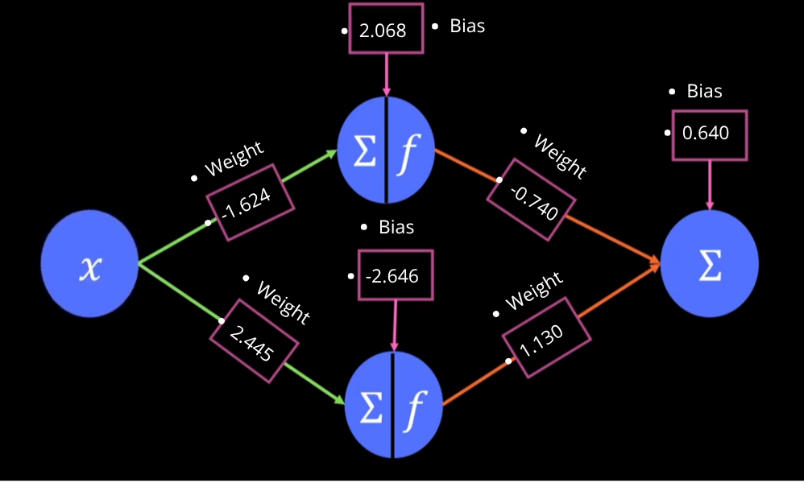
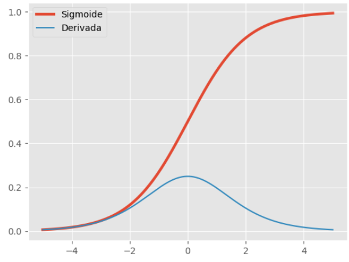

## Avaliação do Modelo:
### Redes Neurais Artificiais

**As Redes Neurais Artificiais (RNAs)** são modelos computacionais utilizados no *Machine Learning* e no *Deep Learning* para identificar padrões e aprender relações entre variáveis a partir de dados. Sua estrutura é inspirada, de maneira simplificada, nas conexões entre neurônios biológicos.

No aprendizado de máquina, cada neurônio do cérebro humano é chamada de *perceptron*. Cada *perceptron* é uma unidade básica da rede para receber as entradas, aplicar os pesos, adicionam um viés (bias) uma espécie de deslocamento, e processam os resultados por meio de funções matemáticas chamadas também de **função de ativação**, que permite à rede aprender relações não lineares. 

Neste estudo, a rede neural é utilizada para estudar a relação entre a idade normalizada do segurado e o valor normalizado do seguro, caracterizando um problema de regressão supervisionada.

### Arquitetura da Rede Neural

A arquitetura implementada possui três etapas principais:

* **Camada de entrada**: recebe a idade normalizada, representada por uma única variável numérica.
* **Camada oculta**: contém dois neurônios artificiais, responsáveis por transformar a entrada e aprender padrões por meio da função de ativação Sigmoid.
* **Camada de saída**: recebe os resultados da camada oculta e produz uma previsão numérica para o valor normalizado do seguro.



Onde:

* **x** = valores de entrada
* **f()** = função de ativação **(Camada Escondida)**



Onde temos agora:

* **w(weight)** = pesos associados às entradas. 

Cada conexão entre os perceptrons possui um peso **(weight)**, que determina como o valor transmitido influencia o cálculo do perceptron seguinte. Os pesos são ajustados durante o treinamento para reduzir o erro entre as previsões e os valores reais.

* **b** = viés(bias), deslocamento à fronteira de decisão.

O **viés (bias)** é um parâmetro adicional somado à combinação ponderada das entradas. Ele permite deslocar a transformação matemática realizada pelo *perceptron*, aumentando a flexibilidade do modelo.

No caso da ilustração acima temos:

A camada **input_layer** recebe uma variável de entrada e produz dois valores, um para cada **perceptron** oculto. A camada **activation** aplica a função *Sigmoid* a esses valores. Por fim, **output_layer** combina os dois resultados e gera uma única previsão.

Como se trata de um problema de regressão, a camada de saída não utiliza uma função de ativação adicional. Dessa forma, o modelo pode produzir valores contínuos, embora suas previsões não fiquem necessariamente restritas ao intervalo de 0 a 1.

## Função de Ativação Sigmoid

A função de ativação Sigmoid é uma função matemática utilizada em redes neurais artificiais para transformar um valor numérico em uma saída entre 0 e 1.

Ela é muito utilizada em problemas de classificação binária, como prever se um aluno será aprovado ou reprovado, ou se uma transação é fraudulenta.

Ela segue esse padrão de curvatura:



## Implementação com PyTorch

```python
class Model(nn.Module):
 def __init__(self, hidden_neurons=2):
  super().__init__()
  self.hidden_neurons = hidden_neurons 
  self.input_layer = nn.Linear( in_features=1, out_features=self.hidden_neurons )
  self.activation = nn.Sigmoid() 
  self.output_layer = nn.Linear( in_features=self.hidden_neurons, out_features=1 )
```
## Treinamento do Modelo:

O treinamento consiste em ajustar os pesos e vieses para aproximar as previsões dos valores conhecidos do conjunto de dados.

Neste estudo, foram definidos os seguintes parâmetros:

| Parâmetro        | Configuração       | Finalidade                               |
| ---------------- | ------------------ | ---------------------------------------- |
| `EPOCHS`         | 1000               | Número máximo de ciclos de treinamento   |
| `LR`             | 0.01               | Taxa de aprendizado do otimizador        |
| `criterion`      | `nn.MSELoss()`     | Calcula o erro quadrático médio          |
| `optimizer`      | `torch.optim.Adam` | Atualiza os parâmetros da rede           |
| `hidden_neurons` | 2                  | Quantidade de perceptrons na camada oculta |

```python
EPOCHS = 1000
LR = 0.01

model = Model(hidden_neurons=2)

criterion = nn.MSELoss()

optimizer = torch.optim.Adam(
    params=model.parameters(),
    lr=LR
)

weights = []
bias = []

for epoch in range(EPOCHS):
    outputs = model(X)
    loss = criterion(outputs, y)

    optimizer.zero_grad()
    loss.backward()
    optimizer.step()

    weights.append(
        model.input_layer.weight.detach().clone()
    )

    bias.append(
        model.input_layer.bias.detach().clone()
    )

    if (epoch + 1) % 100 == 0:
        print(
            f"Época [{epoch + 1}/{EPOCHS}] "
            f"- Loss: {loss.item():.6f}"
        )
```

O processo segue quatro etapas principais:

1. **Propagação direta (*forward pass*):** o modelo recebe `X` e calcula as previsões.
2. **Cálculo da perda:** `MSELoss` compara as previsões com os valores esperados em `y`.
3. **Retropropagação (*backpropagation*):** `loss.backward()` calcula os gradientes dos parâmetros.
4. **Atualização dos parâmetros:** `optimizer.step()` ajusta os pesos e vieses para tentar reduzir a perda.

A instrução `optimizer.zero_grad()` limpa os gradientes anteriores antes de cada novo cálculo.

## O que acontece se você executar os scripts novamente?

Uma nova rede é criada com parâmetros inicializados novamente. Como a inicialização normalmente é aleatória, os pesos, os vieses e a evolução da perda podem ser diferentes a cada execução.

## Os pesos e vieses sempre serão diferentes?

Durante o treinamento, normalmente eles mudam, porque o otimizador atualiza os parâmetros a cada época.

* Pesos (weights): controlam a influência das entradas e das conexões entre os perceptrons.

* Vieses (bias): permitem ajustar o deslocamento da transformação realizada por cada perceptron.


