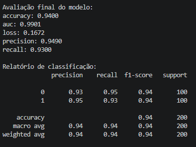

# Avaliação do Modelo - Dataset Moon

O módulo `evaluate.py` é responsável por avaliar o desempenho da rede neural MLP (Multilayer Perceptron) utilizando os dados de teste. Essa etapa permite verificar a capacidade de generalização do modelo, analisando suas previsões em amostras que não participaram do treinamento.

A avaliação é realizada por meio de duas abordagens complementares:

- **Métricas de avaliação do Keras:** calculadas por `model.evaluate()`, incluindo a função de perda e as métricas definidas durante a compilação do modelo.
- **Relatório de classificação:** gerado por `classification_report()`, apresenta métricas detalhadas para cada classe prevista.

## Estrutura da função

A função `avaliar_modelo()` recebe o modelo treinado e os conjuntos de teste `X_test` e `y_test`.

```python
from sklearn.metrics import classification_report


# Avaliação final - Dataset Moon
def avaliar_modelo(model, X_test, y_test):

    # Avaliação com os dados de teste
    resultado = model.evaluate(
        X_test,
        y_test,
        verbose=0,
        return_dict=True
    )

    print("\nAvaliação final do modelo:")

    # Exibir todas as métricas da avaliação
    for metrica, valor in resultado.items():
        print(f"{metrica}: {valor:.4f}")

    # Gerar as probabilidades previstas pelo modelo
    y_pred_prob = model.predict(X_test, verbose=0)

    # Converter as probabilidades em classes 0 ou 1
    y_pred = (y_pred_prob >= 0.5).astype(int).ravel()

    # Exibir o relatório de classificação
    print("\nRelatório de classificação:")
    print(classification_report(y_test, y_pred))

    
    return resultado
```

## Avaliação com `model.evaluate()`

O método `model.evaluate()` calcula a função de perda e as métricas configuradas em `model.compile()`, utilizando os dados de teste.

| Componente | Descrição |
|---|---|
| `model` | Rede neural treinada que será avaliada. |
| `X_test` | Características de entrada das amostras de teste, correspondentes às variáveis `x1` e `x2`. |
| `y_test` | Classes reais associadas às amostras de teste: `0` ou `1`. |
| `verbose=0` | Desativa a exibição do progresso da avaliação no terminal. |
| `return_dict=True` | Retorna as métricas em um dicionário, associando cada nome ao seu valor. |
| `resultado` | Armazena o dicionário com as métricas calculadas. |

Após calcular as métricas de avaliação, o modelo gera previsões para as amostras de teste.

```python
y_pred_prob = model.predict(X_test, verbose=0)
```

O método `model.predict()` retorna as probabilidades estimadas pela camada de saída. Como o modelo utiliza a função de ativação `sigmoid`, cada previsão representa um valor entre `0` e `1`.

### Conversão das probabilidades em classes

```python
y_pred = (y_pred_prob >= 0.5).astype(int).ravel()
```

A expressão converte as probabilidades em classes binárias utilizando o limite de decisão `0.5`.

- Probabilidade menor que `0.5`: classe `0`.
- Probabilidade igual ou maior que `0.5`: classe `1`.
- `.astype(int)`: converte os resultados em números inteiros.
- `.ravel()`: transforma o resultado em um array unidimensional.

O limite de `0.5` é uma escolha inicial comum para classificação binária, podendo ser ajustado conforme os objetivos do problema.

## Relatório de classificação do Dataset Moon

```python
print(classification_report(y_test, y_pred))
```

A função `classification_report()`, disponibilizada pelo Scikit-learn, compara as classes reais (`y_test`) com as classes previstas (`y_pred`) e apresenta as seguintes métricas:

| Métrica | Descrição |
|---|---|
| **Precision** | Proporção de previsões positivas corretas entre todas as previsões positivas realizadas. |
| **Recall** | Proporção de amostras positivas reais identificadas corretamente pelo modelo. |
| **F1-score** | Média harmônica entre precision e recall, equilibrando as duas métricas. |
| **Support** | Quantidade de amostras reais pertencentes a cada classe. |

> O relatório também apresenta a acurácia geral e médias das métricas para o conjunto avaliado.

O módulo `evaluate.py` é executado após o treinamento da rede neural. Seu papel é consolidar os resultados da avaliação e permitir uma análise mais detalhada do desempenho do modelo.

**Observação:** *durante a comparação de arquiteturas e técnicas de regularização, utilize os resultados de validação para orientar a escolha do modelo. Reserve os dados de teste para a avaliação final do modelo selecionado, evitando utilizá-los repetidamente para tomar decisões de ajuste.*

## Análise dos resultados da avaliação

Após executar o treinamento e a avaliação final da rede neural MLP, foram obtidos os seguintes resultados no conjunto de teste, composto por 200 amostras.



### Métricas de avaliação do Keras

| Métrica | Resultado | Interpretação |
|---|---:|---|
| `accuracy` | 0,9400 | 94% das amostras foram classificadas corretamente. |
| `auc` | 0,9901 | Excelente capacidade de distinguir as duas classes ao longo dos diferentes limiares de decisão. |
| `loss` | 0,1672 | Valor da função de perda `binary_crossentropy` no conjunto de teste. |
| `precision` | 0,9490 | Aproximadamente 94,9% das previsões positivas foram corretas. |
| `recall` | 0,9300 | Aproximadamente 93% das amostras positivas reais foram identificadas. |

A acurácia de `0,9400` indica que o modelo classificou corretamente 94% das amostras de teste. Considerando as 200 observações avaliadas, isso corresponde a 188 classificações corretas e 12 incorretas.

A métrica `auc`, com resultado de `0,9901`, indica uma excelente capacidade de discriminação entre as classes. Diferentemente da acurácia, a AUC avalia a capacidade de ordenação das previsões ao longo de diferentes limiares de decisão.

A perda de `0,1672` representa o erro calculado pela função `binary_crossentropy`. Quanto menor esse valor, melhor, desde que a comparação seja feita em condições equivalentes e considerando também o desempenho em dados não utilizados no treinamento.

As métricas `precision` e `recall` apresentadas pelo Keras correspondem, nesse contexto, à classe positiva, ou seja, à classe 1.

### Relatório de classificação

O `classification_report()` apresenta o desempenho individual do modelo para cada classe.

| Classe | Precision | Recall | F1-score | Support |
|---|---:|---:|---:|---:|
| 0 | 0,93 | 0,95 | 0,94 | 100 |
| 1 | 0,95 | 0,93 | 0,94 | 100 |

O conjunto de teste possui 100 amostras de cada classe, totalizando 200 registros. Essa distribuição permite observar o desempenho do classificador nas duas categorias sem que uma delas predomine em quantidade de exemplos.

**Classe 0:** o modelo apresenta `precision` de 93% e `recall` de 95%. Isso significa que identificou corretamente 95 das 100 amostras reais dessa classe, mas algumas previsões de classe 0 corresponderam, na realidade, à classe 1.

**Classe 1:** o modelo apresenta `precision` de 95% e `recall` de 93%. Portanto, 93 das 100 amostras reais dessa classe foram identificadas corretamente, enquanto algumas amostras dessa categoria foram classificadas como classe 0.

O `f1-score` de 0,94 para ambas as classes demonstra um equilíbrio entre precisão e capacidade de identificação, considerando os resultados arredondados apresentados pelo relatório.

A **macro avg** calcula a média aritmética das métricas das classes, atribuindo o mesmo peso a cada uma.

A **weighted avg** calcula a média ponderada pela quantidade de amostras de cada classe. Como o conjunto de teste possui 100 observações da classe 0 e 100 da classe 1, as duas médias apresentam os mesmos resultados neste caso, considerando o arredondamento.

### Interpretação geral do desempenho

Os resultados indicam que a rede neural MLP apresentou bom desempenho na classificação binária do Dataset Moon, **alcançando 94% de acurácia e AUC de 0,9901 no conjunto de teste.**

A proximidade entre as métricas de *precision, recall e F1-score* para as duas classes indica que o modelo conseguiu classificar ambas de maneira equilibrada, sem apresentar uma diferença expressiva de desempenho entre elas.

A **AUC** elevada também sugere que o modelo consegue distinguir bem as duas categorias quando são considerados diferentes limiares de decisão, embora isso não garanta desempenho idêntico em outros conjuntos de dados.

A avaliação final demonstra que o modelo **MLP** obteve resultados consistentes no conjunto de teste do Dataset Moon, com **94%** de **acurácia**, **AUC** de **0,9901** e **F1-score** de **0,94** para ambas as classes.

*Essas métricas fornecem uma visão complementar do desempenho: a acurácia resume a proporção de acertos, a AUC avalia a capacidade de discriminação entre as classes e o relatório de classificação detalha o equilíbrio entre precisão e recall. Os resultados constituem uma referência para comparar futuras versões da rede neural, incluindo experimentos com técnicas de regularização, como Dropout, Batch Normalization e regularização L2. Para que a comparação seja justa, devem ser mantidos critérios consistentes de divisão dos dados e avaliação.*


