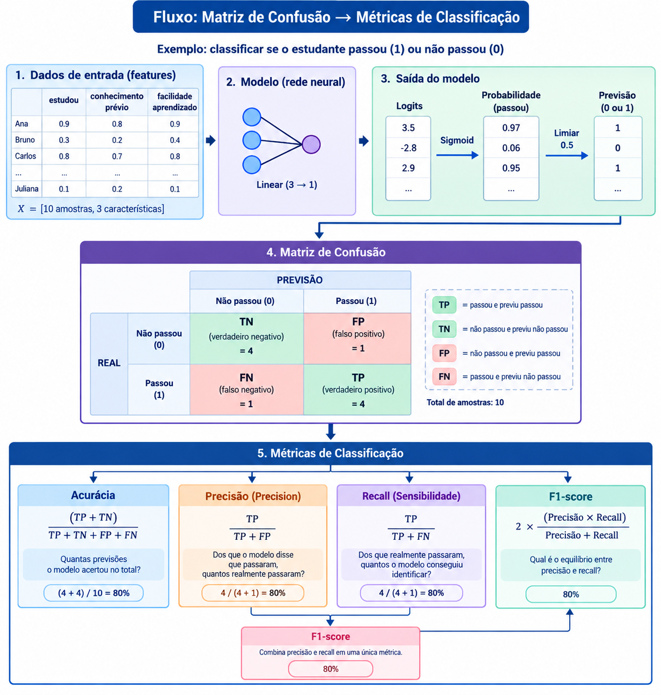

# Deep Learning Classification

## Classificação binária de resultados acadêmicos com PyTorch

Estudos de Machine Learning desenvolvido com Python e PyTorch para explorar um pipeline completo de classificação binária, desde a geração de dados sintéticos até a predição, avaliação do modelo e exportação dos resultados para Excel.

O projeto aplica conceitos de preparação de dados, treinamento supervisionado, inferência e avaliação de métricas de classificação.

---

## Visão geral

O objetivo é construir um modelo capaz de classificar resultados acadêmicos a partir de três características dos estudantes:

* `estudou`
* `conhecimento_previo`
* `facilidade_aprendizado`

A base contém registros com resultados conhecidos, utilizados para treinamento e avaliação, e registros sem resultado, utilizados para gerar previsões.

## Fluxo Inicial do estudo:

## Entendendo o fluxo de classificação e avaliação

Um modelo de classificação binária recebe características de entrada, calcula uma saída e atribui uma classe a cada registro. Para avaliar seu desempenho, comparamos as previsões do modelo com os resultados reais conhecidos.

Neste estudo, o objetivo é classificar os resultados acadêmicos em duas categorias:

* **0 — Reprovado**
* **1 — Aprovado**

O processo começa com três características de cada estudante: `estudou`, `conhecimento_previo` e `facilidade_aprendizado`. Essas informações são fornecidas ao modelo, que utiliza uma camada linear com três entradas e uma saída para calcular um valor chamado *logit*.

Em seguida, a função **sigmoid** transforma esse valor em uma probabilidade entre 0 e 1. Utilizando um limiar de classificação de 0,5, o modelo define a classe prevista: probabilidades iguais ou superiores a 0,5 são classificadas como aprovado (1), enquanto probabilidades inferiores a 0,5 são classificadas como reprovado (0).

### Da previsão à matriz de confusão

A matriz de confusão compara a classe prevista pelo modelo com a classe real de cada estudante. Essa comparação permite identificar quatro situações:

* **Verdadeiro negativo (TN):** o estudante não passou e o modelo previu corretamente a classe 0.
* **Falso positivo (FP):** o estudante não passou, mas o modelo previu a classe 1.
* **Falso negativo (FN):** o estudante passou, mas o modelo previu a classe 0.
* **Verdadeiro positivo (TP):** o estudante passou e o modelo previu corretamente a classe 1.

Esses quatro valores são utilizados para calcular as principais métricas de classificação.

### Como interpretar as métricas

* **Acurácia (*Accuracy*):** mede a proporção total de previsões corretas.
* **Precisão (*Precision*):** indica quantos dos registros previstos como aprovados eram realmente aprovados.
* **Recall (*Sensibilidade*):** mede quantos dos estudantes realmente aprovados foram identificados pelo modelo.
* **F1-score:** combina precisão e recall em uma única métrica, permitindo avaliar o equilíbrio entre ambas.

A análise conjunta dessas métricas oferece uma visão mais completa do desempenho do classificador do que a acurácia isoladamente.

### Exemplo ilustrativo

O diagrama abaixo utiliza uma base hipotética de 10 estudantes, com 4 verdadeiros positivos, 4 verdadeiros negativos, 1 falso positivo e 1 falso negativo. Nesse exemplo, a acurácia, a precisão, o recall e o F1-score são todos iguais a 80%.

**Importante:** esses valores são apenas ilustrativos. Os resultados efetivamente obtidos no treinamento e teste do projeto são apresentados na página [Avaliação do modelo](avaliacao.md).

## Tecnologias utilizadas

| Tecnologia   | Aplicação                                 |
| ------------ | ----------------------------------------- |
| Python       | Linguagem principal                       |
| NumPy        | Geração de dados sintéticos               |
| Pandas       | Manipulação e análise de dados            |
| PyTorch      | Construção e treinamento do modelo        |
| Scikit-learn | Divisão dos dados e métricas de avaliação |
| OpenPyXL     | Leitura e gravação de arquivos Excel      |
| Git e GitHub | Versionamento e documentação              |

## Resultados da avaliação

Essas métricas representam o desempenho obtido no conjunto de teste sintético. Para detalhes sobre a metodologia, a matriz de confusão e a interpretação dos resultados, consulte a página [Avaliação do modelo](avaliacao.md).

## Documentação

* [Pipeline de classificação](pipeline.md) — etapas do processamento, treinamento e geração das previsões.
* [Avaliação do modelo](avaliacao.md) — métricas, matriz de confusão e limitações do experimento.

## Estrutura do projeto

O código está organizado em scripts Python que representam diferentes etapas do fluxo de trabalho, incluindo geração da base, preparação dos dados, treinamento, predição, exportação e avaliação.

## Limitações

Este projeto utiliza dados sintéticos para fins educacionais. Portanto, os resultados obtidos não garantem o mesmo desempenho em dados acadêmicos reais. O experimento tem como foco a aplicação prática dos conceitos de Machine Learning e PyTorch.

---

**Projeto desenvolvido para praticar e documentar um pipeline de classificação binária com Python e PyTorch.**
