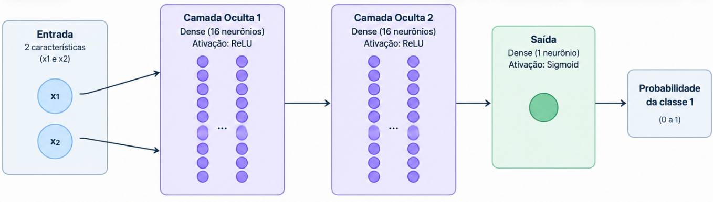

# RNA - Redes Neurais Artificias

### Relembrando um pouco

São modelos de Machine Learning inspirados, de forma simplificada, no funcionamento dos neurônios biológicos. Elas aprendem padrões a partir de dados, ajustando parâmetros internos durante o treinamento para produzir previsões ou classificações.

Uma rede neural geralmente é composta por três partes principais:

- Camada de entrada **(Input Layer)**: recebe as características dos dados.
- Camadas ocultas **(Hidden Layers)**: processam as informações e aprendem padrões.
- Camada de saída **(Output Layer)**: produz o resultado, como uma classe ou um valor numérico.

### Principais tipos de Redes Neurais

* MLP - Multilayer Perceptron

Rede neural composta por camadas de neurônios conectadas entre si, geralmente no sentido da entrada para a saída. É utilizada em classificação e regressão com dados tabulares, como idade, renda, notas e características numéricas.

**É o foco do projeto Dataset Moon.**

* CNN - Convolutional Neural Network

Redes neurais convolucionais, especializadas na identificação de padrões espaciais. São muito utilizadas em imagens, reconhecimento facial, análise de objetos e visão computacional.

* RNN - Recurrent Neural Network

Redes recorrentes, desenvolvidas para processar sequências de informações, nas quais a ordem dos dados importa. Podem ser aplicadas em séries temporais, textos e sequências de eventos.

* LSTM - Long Short-Term Memory

Um tipo de rede recorrente projetado para aprender dependências em sequências mais longas, ajudando a lidar com limitações das RNNs tradicionais.

* Transformers

Arquiteturas que utilizam mecanismos de atenção para relacionar diferentes partes dos dados. São fundamentais em muitos modelos modernos de linguagem e também são utilizadas em imagens e outras modalidades.

*Esses tipos não são necessariamente categorias totalmente isoladas. Por exemplo, uma arquitetura pode combinar convoluções com outras camadas neurais.*

## MLP - Multilayer Perceptron

O **MLP (Multilayer Perceptron)** é uma arquitetura de rede neural **feedforward**: as informações avançam da camada de entrada para as camadas ocultas e, por fim, para a saída.

*No estudo sobre o Dataset Moon, os dados possuem duas características, x1 e x2, e uma variável-alvo, classe.*



### Como cada parte funciona?

1. Entrada

A rede recebe as características que serão utilizadas para realizar a previsão. No **Dataset Moon**, cada observação possui dois valores numéricos: **x1 e x2.**

2. Camadas ocultas

São responsáveis por aprender combinações e padrões dos dados. Cada neurônio recebe valores da camada anterior, aplica pesos e um viés **(bias)** e, normalmente, utiliza uma função de ativação.

3. Funções de ativação

Introduzem não linearidade no modelo, permitindo que a rede aprenda relações mais complexas.

- **ReLU**: retorna zero para entradas negativas e mantém o valor para entradas positivas.
- **Sigmoid**: transforma a saída em um valor entre 0 e 1, útil na classificação binária.

4. Camada de saída

No seu modelo, um único neurônio com **Sigmoid** produz um valor que pode ser interpretado como a probabilidade estimada de pertencer à **classe 1**. Um limiar, frequentemente 0,5, pode ser utilizado para transformar essa estimativa em uma classificação.

### Como o MLP aprende?

O processo de treinamento envolve principalmente:

1. Propagação direta **(Forward Propagation)**: a entrada atravessa a rede e gera uma previsão.
2. Cálculo da perda **(Loss)**: compara a previsão com o resultado esperado.
3. Retropropagação **(Backpropagation)**: calcula como os parâmetros contribuíram para o erro.
4. Otimização: atualiza os pesos e vieses para reduzir a perda ao longo das iterações.

### O que é o Keras?

O **Keras** é uma **API** de alto nível para construir, configurar, treinar e avaliar modelos de Deep Learning. Ele oferece componentes prontos, como camadas, funções de ativação, otimizadores e métricas, permitindo criar redes neurais sem implementar manualmente todas as operações matemáticas.

No estudo, estou utilizando o **Keras** integrado ao **TensorFlow:**

```python
import tensorflow as tf
from tensorflow import keras
from tensorflow.keras import layers
```
### Principais recursos utilizados no Keras aplicado ao dataset Moons:

```python
inputs = keras.Input(shape=(2,))

x = layers.Dense(16, activation="relu")(inputs)
x = layers.Dense(16, activation="relu")(x)

outputs = layers.Dense(1, activation="sigmoid")(x)

model = keras.Model(inputs=inputs, outputs=outputs)
```

Dessa forma:

- **shape=(2,)** = Define as duas características de entrada do conjunto de dados
- **layers.Dense(16)** = Definição de uma camada de perceptrons com 16 neurônios

*Keras é a API utilizada para construir o modelo; MLP é o tipo de arquitetura implementada. O código acima cria a arquitetura, mas ainda não realiza o treinamento.*

### O que é o Dataset Moon?

O ```make_moons``` é uma função do módulo **```sklearn.datasets```** da biblioteca **Scikit-learn.** 
Com essa função é possível gerar conjunto de dados sintéticos para estudar problemas de classificação binária não linear especialmente quando as classes possuem uma fronteira de decisão não linear.

O nome 'Moon' vem do formato dos dados: duas regiões curvas que lembram duas meias-luas entrelaçadas. Cada ponto pertence a uma de duas classes. Diferentemente de um dataset real, os dados são gerados artificialmente.

A documentação oficial do *make_moons()*, do **Scikit-learn**, descreve a função como um gerador de duas classes de dados sintéticos em formato de duas meias-luas entrelaçadas, usado para testar algoritmos de classificação não linear.


A documentação define **X** como uma matriz **NumPy** em formato (n_samples, 2), contendo as coordenadas de cada amostra. Assim também os vetores em NumPy em formato 0 e 1, contendo o rótulo de cada amostra sendo nomeado como **'y'**

Para compreender a estrutura de **X**, utilizei seus atributos para identificar a quantidade de características disponíveis e criar nomes para as colunas:

```python
colunas = []
for i in range(X.shape[1]):
    nome_coluna = f"x{i+1}"
    colunas.append(nome_coluna)
print(colunas)   
```
Nesse trecho, X.shape[1] retorna a quantidade de colunas da matriz. Como o Dataset Moon possui duas características, o resultado é: **["x1","x2"]**

> Esses nomes foram definidos no código para facilitar a identificação das características durante a análise; eles não são nomes fornecidos originalmente pela função make_moons().

Além disso, utilizei a biblioteca Pandas para transformar os dados em um DataFrame, facilitando a inspeção de sua estrutura, a identificação das características e a análise dos rótulos das classes.


> **Obs**: Caso queira reproduzir a exploração de dados local basta executar o script 'dataset_moon.py' que se encontra no repositório do GitHub. 

## Por que esse dataset é interessante para Machine Learning?

Um modelo linear, como a Regressão Logística sem transformações de características, normalmente não consegue separar perfeitamente as duas meias-luas com uma única linha reta.

Já modelos como K-Nearest Neighbors (KNN) ou árvores de decisão podem aprender fronteiras curvas. Isso nos permite estudar:

- Underfitting e overfitting.
- Separação entre treino e teste.
- Comparação entre modelos lineares e não lineares.
- Fronteiras de decisão e regiões de classificação.
- Métricas como precisão, recall, F1-score e matriz de confusão.


