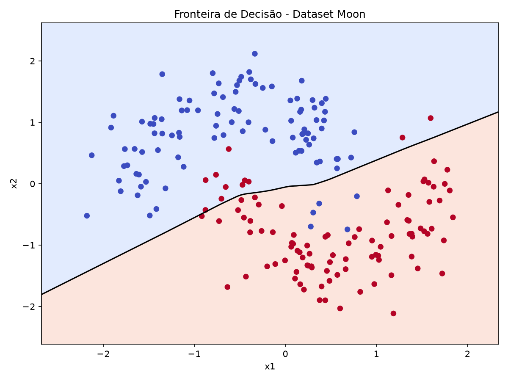
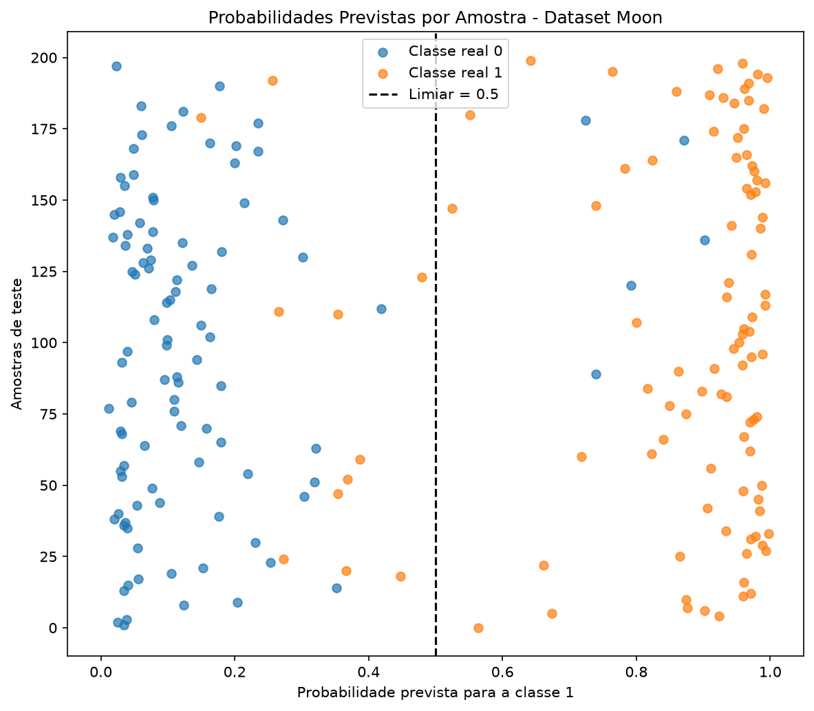
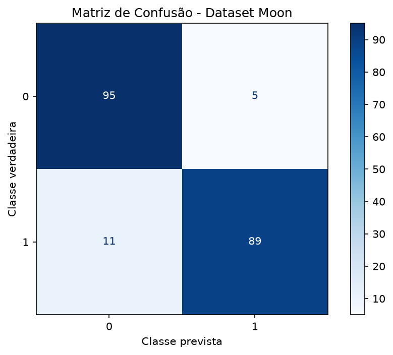
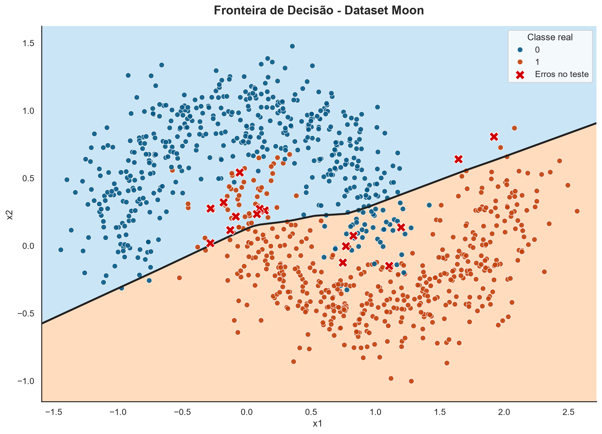

# Fronteira de Decisão - Dataset Moon

A fronteira de decisão permite visualizar como a rede neural MLP (*Multilayer Perceptron*) aprendeu a separar as duas classes do Dataset Moon. Diferentemente das métricas numéricas, essa visualização apresenta as regiões que o modelo associa a cada classe, facilitando a análise do comportamento do classificador.



O gráfico utiliza três elementos principais:

- **Regiões coloridas:** representam as classes previstas pela rede neural em diferentes posições do espaço de características.
- **Pontos:** representam as amostras reais do conjunto de teste, identificadas conforme suas classes verdadeiras.
- **Linha preta:** representa a fronteira de decisão, definida pelo limiar de probabilidade igual a 0,5.

Para construir essa visualização, o script cria uma grade de coordenadas que cobre a região dos dados. Em seguida, o modelo calcula uma probabilidade para cada ponto dessa grade. Essas probabilidades são utilizadas para identificar as regiões de decisão e traçar a fronteira entre as classes.

```python
xx1, xx2 = np.meshgrid(x1, x2)
grade = np.c_[xx1.ravel(), xx2.ravel()]
```

Como foi normalizado **X_train** e **X_test** usando **StandardScaler**, a grade também está sendo criada no espaço normalizado. Isso está correto, porque o modelo foi treinado com dados nesse mesmo espaço.

Em vez de prever apenas os 200 registros de teste, você cria milhares de pontos distribuídos pelo plano. O modelo calcula uma probabilidade para cada um deles:

```python
probabilidades = model.predict(grade, verbose=0)
probabilidades = probabilidades.reshape(xx1.shape)
```

> Essas probabilidades são usadas para desenhar as regiões coloridas e a linha preta.

Quando os pontos de uma classe estão concentrados na região prevista para ela, isso indica que o modelo está classificando corretamente essas amostras. Quando um ponto aparece na região associada à outra classe, existe uma discordância entre a classe real e a previsão do modelo, indicando um possível erro de classificação.

A fronteira apresentada corresponde ao modelo treinado e utiliza as amostras do conjunto de teste para comparação com as classes reais. Como as características foram padronizadas com `StandardScaler`, os eixos representam os valores transformados de `x1` e `x2`, e não suas escalas originais.

*Portanto, essa visualização ajuda a compreender como a MLP aprendeu a estabelecer uma separação não linear entre as classes do Dataset Moon.*

## Distribuição das Probabilidades Previstas - Dataset Moon

O gráfico de distribuição das probabilidades previstas permite analisar as probabilidades atribuídas pela rede neural aos registros do conjunto de teste (`X_test`), comparando-as com suas classes verdadeiras (`y_test`).



*Cada ponto representa uma amostra de teste. O eixo horizontal apresenta a probabilidade prevista pelo modelo para a classe `1`, enquanto o eixo vertical identifica as amostras. As cores distinguem as classes verdadeiras: classe `0` e classe `1`.* 

### Eixo Horizontal:

- Perto de 0: o modelo favorece a classe 0 (Azul) o registro pertence de verdade à classe 0.
- Perto de 1: o modelo favorece a classe 1 (Laranja): o registro pertence de verdade à classe 1.
- Perto de 0.5: o modelo está próximo do limite de decisão

No código de avaliação, essa regra é aplicada assim:

```python
y_pred = (y_pred_prob >= 0.5).astype(int).ravel()
```

A linha vertical tracejada representa o limiar de classificação de `0.5`. Quando a probabilidade prevista é menor que `0.5`, a previsão corresponde à classe `0`. Quando é maior ou igual a `0.5`, a previsão corresponde à classe `1`.

Dessa forma, pontos da classe real `0` posicionados à direita do limiar indicam possíveis erros de classificação. Da mesma maneira, pontos da classe real `1` posicionados à esquerda do limiar indicam previsões incorretas.

### Ponto azul à direita

A classe verdadeira é 0, mas o modelo previu 1. Erro de classificação, chamado falso positivo.

### Ponto laranja à esquerda

A classe verdadeira é 1, mas o modelo previu 0. Erro de classificação, chamado falso negativo.

Essa visualização ajuda a compreender como o modelo distribui suas probabilidades, identificar possíveis erros de classificação e avaliar se as previsões estão coerentes com as classes verdadeiras.

*Visualmente, o modelo parece separar bem a maioria dos registros: os pontos azuis se concentram perto de probabilidades baixas, e os laranjas, perto de probabilidades altas. Entretanto, existem pontos em regiões contrárias às suas classes verdadeiras, indicando possíveis erros.*

## Matriz de Confusão 

A matriz de confusão permite avaliar o desempenho do modelo de classificação, comparando as classes verdadeiras dos registros de teste com as classes previstas pela rede neural. Ela complementa o gráfico de distribuição das probabilidades previstas, permitindo identificar exatamente quantos registros foram classificados corretamente e quantos foram confundidos pelo modelo.



O conjunto de teste contém 200 registros, sendo 100 pertencentes à classe `0` e 100 à classe `1`. Os resultados obtidos foram:

- **95 verdadeiros negativos (TN):** registros da classe real `0` classificados corretamente como `0`.
- **5 falsos positivos (FP):** registros da classe real `0` classificados incorretamente como `1`.
- **7 falsos negativos (FN):** registros da classe real `1` classificados incorretamente como `0`.
- **93 verdadeiros positivos (TP):** registros da classe real `1` classificados corretamente como `1`.

A matriz é calculada pela função confusion_matrix, da biblioteca scikit-learn:

```python
matriz = confusion_matrix(
    y_test,
    y_pred,
    labels=[0, 1]
)
```

* y_test: contém as classes verdadeiras dos registros de teste.
* y_pred: contém as classes previstas pela rede neural.
* labels=[0, 1]: define a ordem das classes na matriz.

*A matriz permite identificar quais classes o modelo está confundindo e quantificar esses erros. No resultado obtido, foram identificados 5 falsos positivos e 7 falsos negativos, além de 188 previsões corretas.*

No gráfico de distribuição das probabilidades, a linha tracejada em `0.5` representa o limiar de classificação. Os registros à esquerda dessa linha são previstos como classe `0`, enquanto os registros à direita, incluindo aqueles exatamente em `0.5`, são previstos como classe `1`.

Ao comparar esse gráfico com a matriz de confusão, identificamos dois tipos de erro:

- **Falsos positivos (5 registros):** são os pontos da classe real `0` que aparecem à direita do limiar de `0.5`. O modelo atribuiu a esses registros uma probabilidade igual ou superior a `0.5` para a classe `1`, classificando-os incorretamente.
- **Falsos negativos (7 registros):** são os pontos da classe real `1` que aparecem à esquerda do limiar de `0.5`. Nesses casos, o modelo atribuiu uma probabilidade inferior a `0.5` para a classe `1`, classificando-os incorretamente como classe `0`.

O modelo classificou corretamente **188 dos 200 registros**, correspondendo a uma acurácia de `94%`. Os 12 registros restantes foram classificados incorretamente, sendo 5 falsos positivos e 7 falsos negativos.

A quantidade de falsos negativos foi ligeiramente superior à de falsos positivos, indicando que o modelo deixou de identificar corretamente 7 registros que realmente pertenciam à classe `1`, enquanto classificou incorretamente 5 registros da classe `0` como pertencentes à classe `1`.

Em conjunto, os dois gráficos oferecem perspectivas complementares: a distribuição das probabilidades permite observar o comportamento das previsões em relação ao limiar de classificação, enquanto a matriz de confusão quantifica os acertos e os erros de cada classe.

*Esses resultados indicam que a rede neural apresentou bom desempenho no conjunto de teste, embora ainda existam registros classificados incorretamente. A análise desses erros pode orientar ajustes futuros no modelo, caso seja necessário melhorar a identificação de uma das classes.*


## Fronteira de Decisão com Valores Completos

A fronteira de decisão com valores originais e completos permite visualizar como a rede neural MLP (*Multilayer Perceptron*) separa as classes do Dataset Moon utilizando as escalas originais das características `x1` e `x2`. Utilizando a técnica de `inverse_transform`:

```python
# Recuperar os valores originais, sem normalização
X_train_original = scaler.inverse_transform(X_train)
X_test_original = scaler.inverse_transform(X_test)
```



Diferentemente da primeira visualização, na qual os eixos representam os valores padronizados, este gráfico apresenta as coordenadas originais do dataset. 

As **Regiões coloridas** representam as classes previstas pela rede neural em cada região do plano. A região azul corresponde à classe 0, enquanto a região laranja corresponde à classe 1.

Os **Pontos** representam as amostras reais do conjunto de teste, posicionadas de acordo com seus valores originais de `x1` e `x2`.

A **Linha preta** representa a fronteira de decisão, que delimita as regiões associadas às duas classes.

O **X vermelhos:** identificam as amostras do conjunto de teste que foram classificadas incorretamente.

### Considerações:

A linha preta demonstra como a MLP aprendeu a estabelecer uma separação não linear entre as classes. Seu formato reflete os padrões identificados durante o treinamento, permitindo observar as regiões em que o modelo prevê cada classe.

Os X vermelhos evidenciam os pontos em que a previsão diverge da classe verdadeira. Esses erros podem ocorrer em regiões de sobreposição entre as classes, especialmente porque o Dataset Moon foi gerado com ruído.

Enquanto a fronteira padronizada apresenta a separação no espaço utilizado pelo modelo, esta versão permite compreender essa mesma separação nas coordenadas originais do dataset.

Assim, as duas visualizações representam perspectivas diferentes da fronteira aprendida pela mesma MLP, sem alterar o treinamento ou o desempenho do modelo.

### Como podemos melhorar a fronteira?

No modelo com Keras, podemos experimentar ajustes graduais:

1. **Arquitetura**: testar diferentes quantidades de neurônios e camadas ocultas.
2. **Épocas**: permitir mais treinamento, acompanhando a perda de validação (val_loss).
3. **Taxa de aprendizado**: ajustar o learning_rate do otimizador Adam.
4. **Regularização**: comparar Dropout, BatchNormalization e L2, verificando se realmente ajudam.
5. **Limiar de classificação**: testar valores como 0,4, 0,5 e 0,6 para mudar a decisão entre as classes.


Uma observação importante: como o dataset contém ruído (noise=0.2), alguns pontos podem estar muito próximos ou até em regiões inesperadas.

Essa visualização também estabelece uma referência para as próximas etapas do estudo. Ao introduzir técnicas como regularização *L2*, *Dropout* e *BatchNormalization*, será possível comparar as fronteiras resultantes e investigar como cada técnica influencia a separação das classes e o desempenho do modelo.


