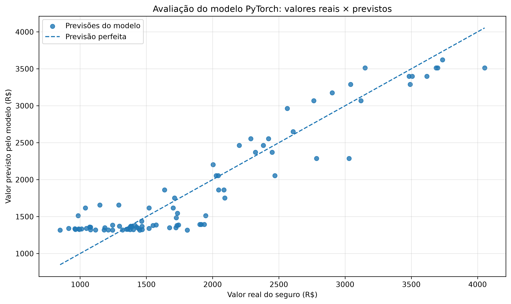

# Análise do Modelo:

A etapa final do estudo tem como objetivo interpretar os resultados obtidos pelo modelo de regressão desenvolvido com PyTorch, avaliando sua capacidade de estimar valores de seguros com base na idade dos clientes.

O script *f_avaliar_previsoes.py* gera previsões para os 85 registros com valores conhecidos, converte as estimativas para a escala monetária original e compara os resultados com os valores reais. A partir dessa comparação, são calculadas as métricas MSE, RMSE, MAE e R², permitindo analisar o desempenho do modelo.

## Métricas de avaliação

Os resultados obtidos na avaliação dos 85 registros conhecidos foram:

| Métrica |     Resultado |
| ------- | ------------: |
| MSE     | 75.860,80 R$² |
| RMSE    |     R$ 275,43 |
| MAE     |     R$ 226,31 |
| R²      |      0,883239 |

### Interpretação:

**MSE — Mean Squared Error**

Representa a média dos erros de previsão elevados ao quadrado. Erros maiores recebem uma penalização mais elevada. Como os valores avaliados estão na escala monetária, o MSE é expresso em reais ao quadrado (R$²).

**RMSE — Root Mean Squared Error**

Corresponde à raiz quadrada do MSE e permite interpretar os erros na mesma unidade dos valores previstos. Neste estudo, o RMSE foi de R$ 275,43.

**MAE — Mean Absolute Error**

Representa a média das diferenças absolutas entre os valores reais e os valores previstos. O resultado de R$ 226,31 indica a magnitude média dos erros absolutos nos registros avaliados.

**R² — Coeficiente de determinação**

O resultado de 0,883239 indica que o modelo explica aproximadamente 88,32% da variação dos valores de seguro observados nesses registros.

Esse resultado descreve o ajuste do modelo aos dados avaliados e não deve ser interpretado isoladamente como garantia de desempenho em novos dados.

O gráfico de valores reais vs valores previstos permite observar a proximidade entre as estimativas e os valores originais.

Pontos próximos à linha de referência representam previsões mais próximas dos valores reais. Distâncias maiores indicam erros mais elevados.

## Aplicação do mesmo modelo nas duas etapas

Após o treinamento, o mesmo modelo de regressão desenvolvido com PyTorch foi utilizado em duas etapas distintas, sem a criação de uma terceira rede neural.

### 1. Avaliação dos 85 registros conhecidos

O modelo recebeu as idades normalizadas dos 85 registros que possuem valores de seguro conhecidos e produziu previsões para esses mesmos registros.

As previsões foram convertidas para a escala monetária original e comparadas com os valores reais do dataset. Essa comparação permitiu calcular as métricas MSE, RMSE, MAE e R².

Como esses registros participaram do treinamento, os resultados representam o ajuste do modelo aos dados utilizados no aprendizado.

### 2. Previsão dos 15 valores ausentes

Como os valores originais desses 15 registros eram desconhecidos, as estimativas não puderam ser comparadas com valores reais para calcular erros individuais.

A partir do mesmo modelo treinado, o fluxo segue por dois caminhos:

* **Avaliação:** 85 registros conhecidos → previsões → comparação com valores reais → métricas de avaliação.
* **Imputação de valores ausentes:** 15 registros sem valor de seguro → previsões → conversão para reais → arquivo com os valores estimados.

Dessa forma, o estudo demonstra tanto a avaliação do ajuste do modelo quanto sua aplicação prática na estimativa de dados ausentes.

## Conclusão

O estudo permitiu desenvolver um fluxo completo de regressão com PyTorch, abrangendo a geração e preparação dos dados, a normalização, o treinamento da rede neural, a avaliação dos resultados e a previsão dos 15 valores de seguro ausentes utilizando o mesmo modelo treinado.

Na avaliação dos 85 registros conhecidos, o modelo apresentou **MAE de R$ 226,31**, **RMSE de R$ 275,43** e **R² de 0,883239**. Embora o coeficiente de determinação indique que o modelo representa aproximadamente 88,32% da variação observada nesses registros, o erro médio demonstra que ainda existe espaço para melhorar a precisão das estimativas. Além disso, como os registros avaliados participaram do treinamento, esses resultados não representam uma avaliação independente da capacidade de generalização.

Como próximos experimentos, serão consideradas as seguintes possibilidades:

* **Aumentar o número de perceptrons na camada oculta:** comparar arquiteturas com 4, 8 e 16 perceptrons, verificando se uma maior capacidade de representação melhora as previsões.
* **Testar diferentes arquiteturas:** avaliar redes com uma ou mais camadas ocultas e diferentes funções de ativação.
* **Ajustar os hiperparâmetros:** experimentar diferentes taxas de aprendizado, quantidades de épocas e configurações do otimizador Adam.
* **Implementar validação:** separar os registros conhecidos em conjuntos de treinamento e validação, comparando o desempenho em dados não utilizados diretamente no ajuste dos pesos.
* **Analisar os erros individuais:** investigar se o modelo apresenta maior dificuldade em determinadas faixas etárias ou em valores de seguro mais elevados.

> Esses experimentos deverão ser comparados utilizando principalmente o MAE e o RMSE na escala monetária, além do R², priorizando as configurações que apresentarem melhor desempenho nos dados de validação.

*Por fim, as previsões dos 15 valores ausentes constituem a aplicação prática do modelo desenvolvido.*

Disponibilizei a documentação técnica do estudo, com explicações sobre a estrutura, os códigos-fonte e as etapas do processo de criação e avaliação de uma rede neural. 

A documentação aborda a preparação e normalização dos dados, a criação de tensores, o treinamento do modelo, a geração de previsões para valores ausentes e a análise dos resultados por meio de métricas de avaliação.

[Documentação técnica](https://github.com/userdanixdev/ml_mlops/tree/artificial_neural_networks){ .md-button }

> 💻 O material está organizado para facilitar a consulta ao código e o entendimento de cada etapa do projeto.

