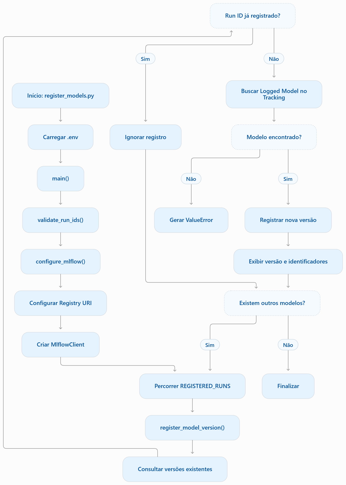

# MLflow Model Registry

O **MLflow Model Registry** é responsável pelo gerenciamento centralizado dos modelos treinados e registrados anteriormente no **MLflow Tracking.**

Enquanto o **Tracking** mantém o histórico de experimentos, parâmetros, métricas, artefatos e execuções (*Runs*), o **Registry** permite organizar os modelos em versões, acompanhar sua origem e controlar seu ciclo de vida.

Nesta etapa do projeto, os modelos registrados durante o processo de treinamento e otimização são encaminhados ao **Model Registry**, sem a necessidade de executar novamente os treinamentos.

## Arquitetura do Registry

O projeto utiliza um único modelo lógico chamado `breast-cancer-classifier`, que mantém as diferentes versões dos modelos desenvolvidos.

| Versão planejada | Modelo de origem |
|---|---|
| v1 | Random Forest Baseline |
| v2 | Logistic Regression Baseline |
| v3 | Random Forest – RandomizedSearchCV |
| v4 | Random Forest – HalvingGridSearchCV |

**A numeração efetiva das versões é atribuída automaticamente pelo MLflow durante o registro.**

O diagrama abaixo representa o processo de transferência dos modelos do `Tracking` para o `Registry.`



A implementação foi organizada dentro do pacote `tracking`, mantendo a separação de responsabilidades.

| Arquivo | Responsabilidade |
|---|---|
| `mlflow_config.py` | Configuração do MLflow Tracking. |
| `register_optimization.py` | Registro dos experimentos, métricas e modelos no Tracking. |
| `register_models.py` | Registro e versionamento dos modelos no Model Registry. |
| `.env` | Armazenamento local dos Run IDs. |
| `.env.example` | Referência das variáveis necessárias para configurar o projeto. |

> Para evitar deixar os identificadores das execuções fixados diretamente no código, os Run IDs foram transferidos para variáveis de ambiente.

O arquivo `.env` contém os identificadores das quatro execuções:

```env
MLFLOW_RUN_RANDOM_FOREST=seu_run_id
MLFLOW_RUN_LOGISTIC_REGRESSION=seu_run_id
MLFLOW_RUN_RANDOMIZED_SEARCH=seu_run_id
MLFLOW_RUN_HALVING_SEARCH=seu_run_id
```

**O arquivo `.env` não deve ser versionado.**

> O arquivo `.env.example` é versionado e contém apenas os nomes das variáveis, sem os valores locais.

*Os Run IDs são identificadores de rastreabilidade, não credenciais de autenticação. O uso do `.env` mantém a configuração local separada do código-fonte.*

## register_models.py

`src/mlops/tracking/register_models.py`

Recupera os modelos já logados no `Tracking` e registrá-los como versões no `Model Registry.`

### Função `validate_run_ids()`

Essa função verifica se todos os Run IDs necessários foram carregados corretamente.

Caso alguma variável esteja ausente ou vazia, é gerado um `ValueError`, interrompendo a execução antes de iniciar o registro. 
Isso evita que o processo seja executado com configurações incompletas.

### Função `register_model_version()`

É a principal função do script.

Recebe três argumentos:

- `client`: cliente de comunicação com o Registry.
- `model_name`: nome descritivo do modelo.
- `run_id`: identificador da execução no Tracking.

O processo executado pela função é:

1. Consultar as versões existentes do modelo registrado.
2. Verificar se o Run ID já está associado a uma versão.
3. Caso já exista, interromper o registro daquele modelo.
4. Caso não exista, recuperar o modelo logado no Tracking.
5. Identificar o modelo `sklearn_model`.
6. Construir o identificador do modelo logado.
7. Registrar uma nova versão no Model Registry.

A recuperação do modelo logado utiliza:

```python
logged_models = mlflow.search_logged_models(
    filter_string=f"source_run_id='{run_id}'",
    output_format="list",
)
```

No MLflow 3, o identificador do modelo logado pode ser utilizado para construir sua URI:

```python
model_uri = f"models:/{logged_model.model_id}"
```
### Metadados e tags

Durante o registro, são adicionadas duas tags:

| Tag | Valor | Finalidade |
|---|---|---|
| `source_run_name` | Nome do modelo | Identificar a origem da versão. |
| `validation_status` | `pending` | Indicar que a avaliação ainda está pendente. |

> Esses metadados ajudam a organizar as versões e preparar a etapa de seleção do modelo.

### Função `main()`

A função `main()` coordena o processo de registro.

Suas responsabilidades são:

1. Carregar as variáveis do `.env`.
2. Validar os Run IDs.
3. Configurar o MLflow.
4. Definir o Registry URI.
5. Instanciar o `MlflowClient`.
6. Percorrer o dicionário de modelos.
7. Executar `register_model_version()` para cada modelo.

O Registry utiliza o mesmo banco SQLite configurado para o Tracking:

```text
sqlite:///mlflow_project_cancer.db
```

A configuração é realizada por:

```python
mlflow.set_registry_uri(mlflow.get_tracking_uri())
```

Dessa maneira, o Tracking e o Registry compartilham o mesmo armazenamento local.

Com o ambiente configurado e os Run IDs disponíveis no `.env`, a execução é realizada a partir da raiz do projeto:

```powershell
poetry run python src/mlops/tracking/register_models.py
```

O script processa os quatro modelos e cria as versões correspondentes no Registry.

Caso seja executado novamente, os Run IDs já registrados serão identificados e não gerarão versões duplicadas para as mesmas execuções.

## Diferença entre Tracking e Registry

| MLflow Tracking | MLflow Model Registry |
|---|---|
| Registra experimentos e execuções. | Gerencia modelos registrados. |
| Armazena parâmetros e métricas. | Controla versões dos modelos. |
| Mantém artefatos e resultados. | Mantém metadados e aliases. |
| Permite comparar experimentos. | Permite selecionar modelos para uso. |
| Acompanha o desenvolvimento. | Gerencia o ciclo de vida dos modelos. |

> Os dois componentes trabalham juntos: o Tracking fornece a origem e o histórico das execuções, enquanto o Registry organiza os modelos que poderão ser utilizados em ambientes posteriores.

Após o registro e versionamento, o projeto seguirá para:

1. Avaliação comparativa das versões.
2. Inclusão de descrições e metadados adicionais.
3. Definição de aliases, como `champion`, para identificar o modelo selecionado.
4. Recuperação da versão escolhida para integração com FastAPI.
5. Disponibilização do modelo por meio do endpoint `/predict`.

A escolha do modelo não será feita exclusivamente pela acurácia. Serão considerados também F1 Macro, precisão, recall e desempenho individual das classes.

Ao concluir esta etapa, os quatro modelos desenvolvidos no projeto estarão centralizados no `MLflow Model Registry, com versionamento e rastreabilidade até suas execuções originais. Isso estabelece a base para o gerenciamento do ciclo de vida do modelo e sua futura utilização no serviço de predição.

Conslte a documentação técnica aqui:

[Documentação Técnica - MLflow Model Registry](https://github.com/userdanixdev/ml_mlops/blob/project_mlops/src/mlops/tracking/register_models.py){ .md-button}
