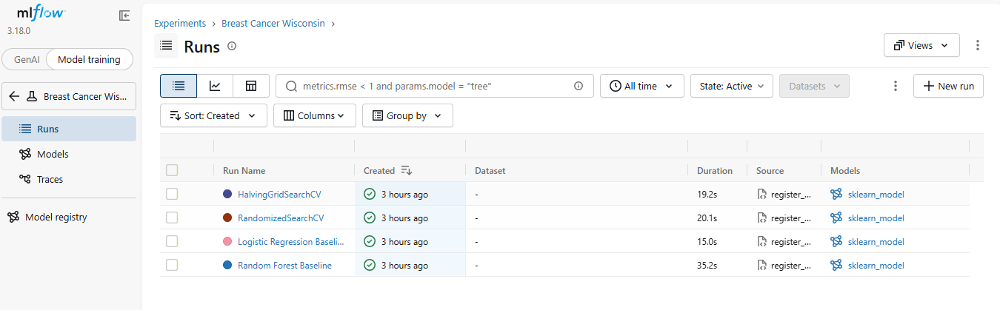

# MLflow Tracking

O `MLflow Tracking` é utilizado para registrar, organizar e acompanhar os experimentos de `Machine Learning` desenvolvidos no projeto. Ele organiza as execuções de Machine Learning por meio de experimentos e Runs.

### Experiments

Um experimento agrupa execuções relacionadas a um mesmo objetivo ou conjunto de estudos.

Neste projeto, foi criado o experimento:

- **Breast Cancer Wisconsin**

> Todos os modelos baseline e otimizados foram registrados dentro desse experimento.

### Runs

Um Run representa uma execução registrada no MLflow.

Cada Run pode armazenar:

- Parâmetros utilizados pelo modelo;
- Métricas de avaliação;
- Tags para identificação;
- Modelos treinados;
- Arquivos e relatórios;
- Gráficos e outros artefatos.

> Para este projeto, cada modelo foi registrado em um Run independente, permitindo comparar os resultados sem misturar suas informações.

### Parameters

Os parâmetros representam as configurações utilizadas durante a construção ou otimização dos modelos.

Exemplos:

- `n_estimators`;
- `max_depth`;
- `min_samples_split`;
- `min_samples_leaf`;
- `max_features`;
- `max_iter`.

> Nos modelos baseline, são registrados os parâmetros definidos inicialmente. Nos modelos otimizados, são registrados os melhores hiperparâmetros encontrados pelas técnicas de busca.

### Metrics

As métricas representam os resultados quantitativos obtidos durante a avaliação dos modelos.

Neste projeto, foram registradas métricas como:

- Accuracy;
- Precision;
- Recall;
- F1-score;
- F1 Macro;
- F1 Weighted.

*As métricas de avaliação no conjunto de teste foram recuperadas do arquivo `reports/model_metrics.csv`.*

> Para os modelos otimizados, também foram registradas as métricas da validação cruzada, permitindo distinguir o desempenho médio durante a busca do desempenho obtido no conjunto de teste.

### Artifacts

Os artefatos são arquivos associados a cada `Run.`

Neste projeto, foram registrados:

- Modelos no formato MLflow Scikit-learn;
- Arquivos Joblib originais;
- CSVs com os resultados das otimizações;
- Relatórios Markdown;
- Gráficos de avaliação e otimização;

*Nesta etapa, o objetivo foi centralizar os resultados dos modelos baseline e dos modelos otimizados, permitindo acompanhar seus parâmetros, métricas de avaliação, arquivos gerados e versões dos modelos registrados.*

Foram registrados quatro modelos:

- Random Forest Baseline;
- Logistic Regression Baseline;
- Random Forest otimizado com RandomizedSearchCV;
- Random Forest otimizado com HalvingGridSearchCV.

**O MLflow permite acompanhar esses experimentos em uma interface centralizada, facilitando a comparação dos resultados antes da seleção do modelo que seguirá para implantação.**

## Arquitetura e organização dos arquivos

A implementação do `Tracking` foi desenvolvida em um módulo independente, mantendo separadas as responsabilidades de treinamento, otimização e rastreamento.


```text
ml_mlops/
│
├── models/
│   ├── model_1_random_forest.joblib
│   ├── model_2_logistic_regression.joblib
│   ├── model_3_random_forest_optimized.joblib
│   └── model_4_random_forest_halving_optimized.joblib
│
├── reports/
│   ├── model_metrics.csv
│   │
│   └── optimization/
│       ├── randomized_search_results.csv
│       ├── randomized_search_report.md
│       ├── randomized_search_best_metrics.png
│       ├── randomized_search_parameters.png
│       ├── randomized_search_scores.png
│       ├── halving_search_results.csv
│       ├── halving_search_report.md
│       ├── halving_best_model_evaluation.png
│       ├── halving_candidates_per_iteration.png
│       └── halving_resources_per_iteration.png
│
├── src/
│   └── mlops/
│       └── tracking/
│           ├── __init__.py
│           ├── mlflow_config.py
│           └── register_optimization.py
│
└── mlflow_project_cancer.db
```

**O banco SQLite é utilizado como armazenamento local dos metadados do MLflow Tracking. Evitando a necessidade inicial de configurar um servidor externo de banco de dados.**

> Os arquivos dos modelos, relatórios, resultados das otimizações e gráficos permanecem organizados nos respectivos diretórios do projeto, sendo também registrados como artefatos dos experimentos.

A configuração foi implementada no módulo `src/mlops/tracking/mlflow_config.py` e a função `configure_mlflow()` centraliza essas configurações e é reutilizada pelo script de registro dos modelos.

### Inicialização do Tracking

Para inicializar a configuração:

```powershell
poetry run python src/mlops/tracking/mlflow_config.py
```

>> Na primeira execução, o MLflow cria as tabelas necessárias no banco SQLite e registra o experimento, caso ele ainda não exista.

Para visualizar os experimentos, foi utilizado o comando:

```powershell
poetry run mlflow ui --backend-store-uri sqlite:///mlflow_project_cancer.db
```

*A interface permite acompanhar as execuções, visualizar métricas, parâmetros e artefatos associados a cada Run.*

## Registro dos modelos no MLflow

O registro dos experimentos foi implementado em:

`src/mlops/tracking/register_optimization.py`

Esse módulo centraliza o processo de registro dos quatro modelos.
Uma característica importante da implementação é que ela não executa novamente os treinamentos ou as otimizações.

Os modelos já treinados são carregados por meio do `Joblib`, enquanto as métricas e os resultados são recuperados dos arquivos produzidos nas etapas anteriores do pipeline.

O **Joblib** permite recuperar os modelos previamente treinados:
```python
model = joblib.load(model_path)
```

**Dessa forma, os modelos existentes são reutilizados para o registro no MLflow.**

### Registro dos parâmetros

O método `mlflow.log_params()` registra os parâmetros associados a cada modelo.

Exemplo:

```python
mlflow.log_params({
    key: str(value)
    for key, value in config["params"].items()
})
```

- Para os modelos baseline, são utilizados os parâmetros definidos durante o treinamento.

- Para os modelos otimizados, os melhores hiperparâmetros são recuperados dos arquivos CSV.

### Recuperação dos melhores hiperparâmetros

Os resultados das técnicas de otimização foram armazenados em:

1. reports/optimization/randomized_search_results.csv;
2. reports/optimization/halving_search_results.csv.


A função `get_best_results()` identifica a linha com a maior pontuação em `mean_test_score:`

```python
results = pd.read_csv(results_path)

best_row = results.loc[
    results["mean_test_score"].idxmax()
]

best_params = ast.literal_eval(best_row["params"])
```

O campo `params` contém a combinação de hiperparâmetros avaliada em cada candidato.

A conversão com `ast.literal_eval()` permite recuperar essa combinação como um dicionário Python.

> Assim, o registro utiliza os melhores parâmetros encontrados sem executar novamente o `RandomizedSearchCV` ou o `HalvingGridSearchCV`.

### Registro das métricas

As métricas de teste são recuperadas do arquivo:

`reports/model_metrics.csv`

A função `get_test_metrics()` seleciona a linha correspondente ao modelo e prepara os valores para registro `mlflow.log_metrics(metrics)`

Os nomes das métricas recebem o prefixo `test_`, identificando que representam a avaliação no conjunto de teste.

Exemplos:

```python
test_accuracy;
test_macro_avg_f1_score;
test_weighted_avg_f1_score;
test_malignant_f1_score;
test_benign_f1_score.
```

> Os campos de suporte das classes não são registrados como métricas, pois representam a quantidade de amostras utilizadas na avaliação.

### Métricas da validação cruzada

Além das métricas de teste, os modelos otimizados possuem registros específicos da validação cruzada.
```python
mlflow.log_metric(
    "cv_f1_macro",
    float(best_row["mean_test_score"]),
)

mlflow.log_metric(
    "cv_f1_macro_std",
    float(best_row["std_test_score"]),
)
```

A métrica `cv_f1_macro` representa a média do **F1 Macro** obtida durante a validação cruzada da busca. Já `cv_f1_macro_std` representa o desvio-padrão entre os resultados das divisões utilizadas na validação.

### Registro dos modelos e artefatos

Os modelos são registrados no formato Scikit-learn do MLflow:

```python
mlflow.sklearn.log_model(
    sk_model=model,
    name="sklearn_model",
    skops_trusted_types=[
        "sklearn.tree._tree.Tree"
    ],
)
```

*O formato `MLflow Scikit-learn` permite armazenar o modelo com as informações necessárias para sua utilização posterior por meio da integração do MLflow.*

Também é mantido o arquivo Joblib original:

```python
mlflow.log_artifact(
    str(model_path),
    artifact_path="joblib_backup",
)
```

Os relatórios, CSVs e gráficos são registrados por meio de mlflow.`log_artifact().`

Essa implementação permite manter tanto o modelo no formato MLflow quanto uma cópia do arquivo original utilizado no projeto.

> **Observação de segurança**: durante a implementação, o MLflow identificou o tipo `sklearn.tree._tree.Tree` como não confiável na serialização com Skops. Como os modelos são produzidos pelo próprio projeto e sua origem é conhecida, esse tipo específico foi explicitamente autorizado por meio de skops_trusted_types.

### Registro dos modelos baseline

Os modelos baseline representam as referências iniciais de desempenho do projeto, antes da aplicação das técnicas de otimização. Foram registrados dois modelos:

### 1.Random Forest Baseline

O modelo foi carregado em `models/model_1_random_forest.joblib` e as métricas de teste foram recuperadas do arquivo geral de avaliação.

### 2. Logistic Regression Baseline

O modelo utiliza um Pipeline do Scikit-learn com padronização das variáveis e classificação logística. O modelo foi carregado em `models/model_2_logistic_regression.joblib` e o registro preserva o Pipeline completo, incluindo o StandardScaler e o classificador.

### Registro dos modelos otimizados

Após o treinamento dos modelos baseline, foram aplicadas duas técnicas de otimização de hiperparâmetros.

### RandomizedSearchCV

O `RandomizedSearchCV` realiza uma busca aleatória por combinações de hiperparâmetros dentro dos espaços definidos. O modelo otimizado foi carregado em `models/model_3_random_forest_optimized.joblib` e os resultados foram recuperados em reports: `reports/optimization/randomized_search_results.csv`. O relatório e os gráficos associados também foram registrados como artefatos e a melhor pontuação de F1 Macro na validação cruzada foi:
`0,9554`

### HalvingGridSearchCV

O `HalvingGridSearchCV` utiliza uma estratégia de busca sucessiva, eliminando candidatos com resultados inferiores e direcionando mais recursos aos candidatos que apresentam melhor desempenho.O modelo otimizado foi carregado em `models/model_4_random_forest_halving_optimized.joblib`. Os resultados foram recuperados em `reports/optimization/halving_search_results.csv`

Também foram registrados o relatório e os gráficos que representam as iterações, os candidatos e os recursos utilizados. A melhor pontuação de F1 Macro na validação cruzada foi `0,9464`

> Após o registro, o experimento passou a conter quatro Runs independentes. Dessa forma as métricas de teste mostram que a **Regressão Logística** baseline apresentou a maior acurácia entre os quatro modelos.

Os dois **Random Forest** otimizados apresentaram a mesma acurácia no conjunto de teste, embora tenham sido encontrados por técnicas de otimização diferentes.

O **RandomizedSearchCV** apresentou a maior pontuação média de F1 Macro na validação cruzada entre as duas buscas.

Esses resultados demonstram que a aplicação de técnicas de otimização não garante necessariamente um desempenho superior ao baseline. A seleção do modelo final deverá considerar as métricas de avaliação, a capacidade de generalização, os requisitos da aplicação e o objetivo do problema.

O registro dos quatro modelos é executado por meio do comando:
```
poetry run python src/mlops/tracking/register_optimization.py
```

A função `main()`  executa as seguintes operações:

- Configura a conexão com o MLflow Tracking.
- Registra o Random Forest baseline.
- Registra a Logistic Regression baseline.
- Registra o modelo otimizado pelo RandomizedSearchCV.
- Registra o modelo otimizado pelo HalvingGridSearchCV.

Cada modelo é registrado em um Run independente dentro do experimento `Breast Cancer Wisconsin.`

> Cada nova execução do script cria novos Runs, preservando o histórico das execuções anteriores.

### Visualização no MLflow UI

A interface gráfica pode ser inicializada com:

`poetry run mlflow ui --backend-store-uri sqlite:///mlflow_project_cancer.db`

Na interface, o experimento `Breast Cancer Wisconsin` apresenta os quatro Runs registrados.



### MLflow Tracking e MLflow Model Registry

É importante diferenciar o Tracking do Model Registry.

1. MLflow Tracking

Responsável pelo acompanhamento dos experimentos, registrando parâmetros, métricas, Runs e artefatos.

2. MLflow Model Registry

Responsável pelo gerenciamento do ciclo de vida dos modelos, incluindo versionamento, organização e controle dos modelos selecionados para utilização.

> Nesta etapa, foi implementado o MLflow Tracking e os modelos foram registrados como modelos MLflow associados aos Runs. O próximo passo será trabalhar com o Model Registry para organizar as versões e selecionar o modelo que seguirá para implantação.

### Considerações

A implementação do `MLflow Tracking` permitiu centralizar os resultados das etapas de treinamento e otimização do projeto. Os quatro modelos foram registrados individualmente, preservando seus parâmetros, métricas, modelos e artefatos associados.

A utilização do MLflow também reduziu a necessidade de desenvolver manualmente uma estrutura de rastreamento de experimentos, permitindo que os módulos de treinamento, otimização e avaliação permaneçam independentes.

Com essa etapa concluída, o projeto passa a ter uma estrutura de acompanhamento experimental mais organizada e preparada para avançar ao MLflow Model Registry, monitoramento de Data Drift e implantação da API de predição.

Para consultar o material técnico completo clique aqui:

[Documentação Técnica - MLflow Tracking](){. md-button}