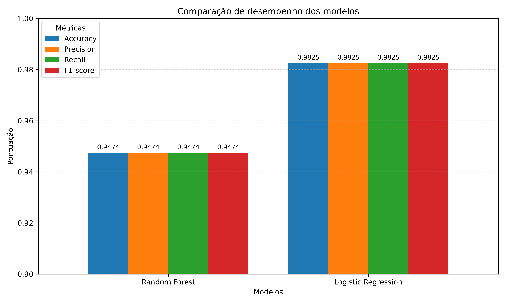
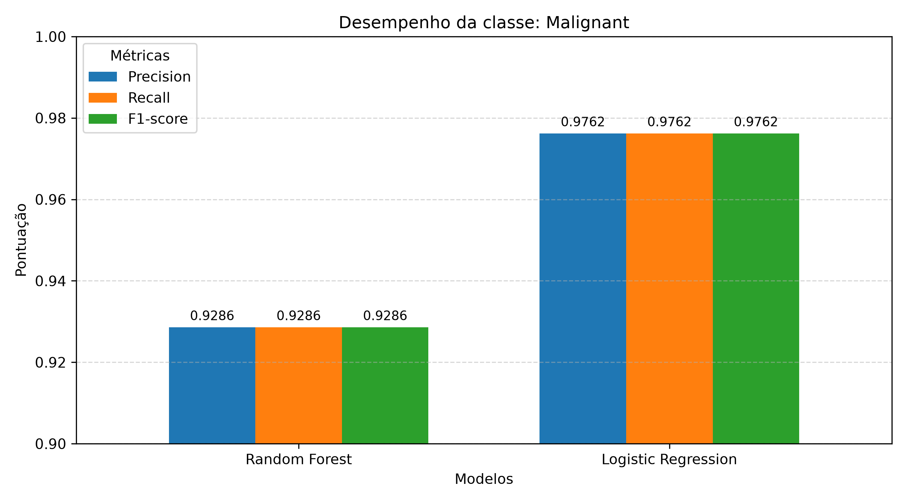
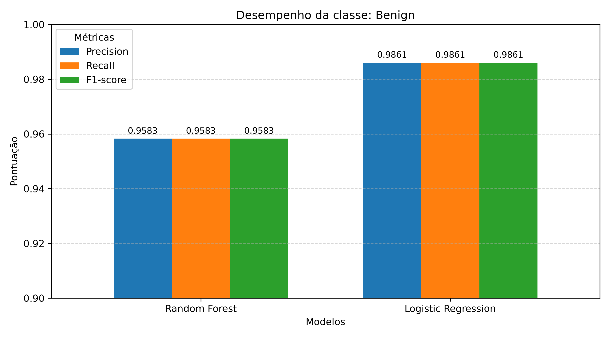

# Comparação dos Modelos

Nesta etapa, foi realizada a comparação de desempenho entre os modelos **Random Forest** e **Logistic Regression**, utilizando as métricas obtidas durante a avaliação dos modelos.

Os resultados foram armazenados no arquivo `reports/model_metrics.csv`, permitindo que os gráficos fossem gerados sem a necessidade de executar novamente as previsões ou carregar os modelos salvos em Joblib.

O primeiro gráfico apresenta a comparação das seguintes métricas:

- **Accuracy:** proporção de previsões corretas em relação ao total de amostras.
- **Precision:** proporção de previsões positivas que realmente pertencem à classe prevista.
- **Recall:** proporção de exemplos positivos que foram corretamente identificados.
- **F1-score:** média harmônica entre Precision e Recall.

## Desempenho da classe Malignant

Este gráfico apresenta a comparação de Precision, Recall e F1-score para a classe `malignant`, correspondente aos casos malignos.

## Desempenho da classe Benign

Este gráfico apresenta a comparação de Precision, Recall e F1-score para a classe `benign`, correspondente aos casos benignos.

Com base nos resultados registrados, os modelos apresentaram os seguintes valores de Accuracy:

| Modelo | Accuracy |
|---|---:|
| Random Forest | 94,74% |
| Logistic Regression | 98,25% |

*A Regressão Logística apresentou desempenho superior ao Random Forest neste experimento, considerando as métricas avaliadas.*

Caso queira verificar o código completo acesse aqui:

[Plot dos gráficos]()