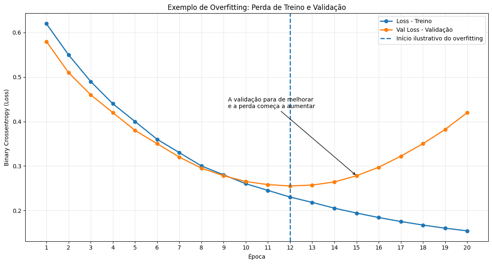
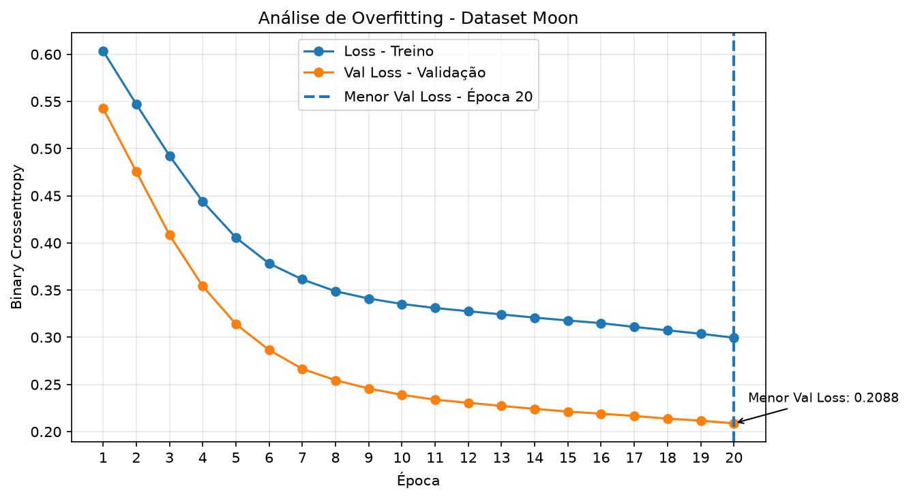

# Overfitting:

## Exemplo de Overfitting: Perda de Treino e Validação



- **Linha azul(Loss de treino):** continua diminuindo, indicando que o modelo reduz o erro nos dados utilizados para aprender.
- **Linha laranja(Val Loss)**: diminui inicialmente, mas começa a aumentar depois de atingir seu menor valor.
- **Linha tracejada(Época 12)**: marca aproximadamente o ponto a partir do qual o overfitting começa a ficar evidente neste exemplo ilustrativo.

O que acontece? O modelo continua aprendendo os dados de treinamento, mas seu desempenho nos dados de validação começa a piorar. Isso pode indicar que ele está se ajustando excessivamente aos exemplos de treinamento e perdendo capacidade de generalização.

> **Importante**: os valores deste gráfico são ilustrativos, não foram extraídos do treinamento real, portanto, eles não nos mostram esse padrão de overfitting.

### Análise do Dataset Moon



## Identificação de possíveis sinais de Overfitting

### O que é Overfitting?

O *overfitting* (sobreajuste) ocorre quando uma rede neural aprende muito bem os padrões e particularidades dos dados de treinamento, mas apresenta dificuldades para generalizar esse aprendizado para dados que não foram utilizados durante o ajuste dos parâmetros do modelo.

Durante o treinamento, o modelo ajusta seus pesos e vieses para reduzir a função de perda (*loss*). Entretanto, a redução do erro nos dados de treinamento não significa necessariamente que o modelo esteja melhorando seu desempenho em dados novos.

Para acompanhar esse comportamento, o Keras permite monitorar duas métricas importantes:

- **`loss`**: representa a perda calculada sobre os dados de treinamento em cada época.
- **`val_loss`**: representa a perda calculada sobre os dados de validação em cada época.

A comparação entre essas duas curvas ajuda a identificar possíveis sinais de sobreajuste durante o treinamento da rede neural.

No estudo Dataset Moon, foi implementada uma regra simples para verificar se o histórico de treinamento apresenta indícios de overfitting.

```python
# Verificação simples de possíveis sinais de overfitting
loss_validacao = history.history["val_loss"]

sinais_overfitting = (
    loss_treino < menor_val_loss
    and melhor_epoch < total_epochs
    and loss_validacao[-1] > menor_val_loss
)

   # Exibir análise de overfitting
    largura = 60

    print("\n" + "=" * largura)
    print("ANÁLISE DE OVERFITTING".center(largura))
    print("=" * largura)

    if sinais_overfitting:
        print("Status: POSSÍVEIS SINAIS IDENTIFICADOS")
        print("-" * largura)
        print("A perda de validação aumentou após atingir")
        print("seu menor valor durante o treinamento.")
    else:
        print("Status: NENHUM SINAL CLARO IDENTIFICADO")
        print("-" * largura)
        print("A regra utilizada não identificou sinais")
        print("claros de overfitting.")

    print("=" * largura + "\n")    
        
    return history
```

*O código utiliza o histórico produzido pelo treinamento da rede neural para avaliar se a perda de validação aumentou após atingir seu menor valor.*

**Importante:** essa implementação é uma verificação heurística, ou seja, uma regra simples de análise. Ela não comprova, isoladamente, a existência ou a ausência de overfitting.

A variável `sinais_overfitting` recebe o resultado de três condições conectadas pelo operador lógico `and`.

Isso significa que **as três condições precisam ser verdadeiras simultaneamente** para que a variável receba `True`.

#### Primeira condição: `loss_treino < menor_val_loss`

Compara a perda de treinamento com o menor valor da perda de validação.

#### Segunda condição: `melhor_epoch < total_epochs`

Verifica se a época em que a menor perda de validação foi registrada ocorreu antes da última época do treinamento.

Por exemplo, se o treinamento foi configurado para 20 épocas e a menor perda de validação ocorreu na 13ª época, temos:

```python
melhor_epoch = 13
total_epochs = 20

melhor_epoch < total_epochs  # True
```

> Isso indica que o modelo continuou treinando após atingir seu melhor resultado de validação.

*Essa condição, sozinha, não indica overfitting: a perda de validação pode continuar estável ou até melhorar depois de oscilações.*

#### Terceira condição: `loss_validacao[-1] > menor_val_loss`

Essa condição verifica se a perda de validação na última época foi maior do que o menor valor registrado durante todo o treinamento.

O índice `-1` acessa o último elemento da sequência `loss_validacao`.

Por exemplo:

```python
loss_validacao = [0.55, 0.43, 0.34, 0.28, 0.30, 0.36]

menor_val_loss = min(loss_validacao)

loss_validacao[-1] > menor_val_loss  # True
```

A menor perda foi `0.28`, mas a última perda foi `0.36`. Portanto, a perda de validação aumentou em relação ao seu melhor resultado.

Esse comportamento pode indicar que o modelo está perdendo capacidade de generalização durante as últimas épocas.

### Combinando as condições

```python
sinais_overfitting = (
    loss_treino < menor_val_loss
    and melhor_epoch < total_epochs
    and loss_validacao[-1] > menor_val_loss
)
```

A regra procura identificar uma situação em que:

1. A perda de treinamento é inferior à menor perda de validação.
2. O melhor resultado de validação aconteceu antes da última época.
3. A perda de validação terminou acima do seu menor valor.

Quando as três condições são satisfeitas, o programa considera que existem possíveis sinais de overfitting.

*Observe que a terceira condição identifica uma diferença entre o melhor resultado de validação e o resultado final, mas não garante que a perda tenha aumentado continuamente. Para avaliar essa tendência, é necessário observar a sequência completa dos valores.*

### Como melhorar essa verificação

A regra atual é útil como exercício de análise, mas pode ser aprimorada. Uma alternativa é verificar se a perda de validação aumentou durante várias épocas consecutivas após atingir seu mínimo, em vez de comparar somente o melhor e o último valor.

Outra técnica é utilizar o *Early Stopping* do Keras, que monitora uma métrica, como `val_loss`, e pode interromper o treinamento quando não há melhora suficiente durante um número definido de épocas.

```python
from tensorflow import keras

early_stopping = keras.callbacks.EarlyStopping(
    monitor="val_loss",
    patience=5,
    restore_best_weights=True
)
```

Para utilizar essa técnica, o callback deve ser passado ao `model.fit()`:

```python
history = model.fit(
    X_train,
    y_train,
    validation_split=0.2,
    epochs=total_epochs,
    batch_size=32,
    callbacks=[early_stopping],
    verbose=0
)
```

Com `patience=5`, o treinamento pode ser interrompido quando a `val_loss` deixa de melhorar por cinco épocas consecutivas, respeitando as regras do callback. Com `restore_best_weights=True`, os pesos são restaurados para aqueles da época com o melhor resultado da métrica monitorada.

> *O *Early Stopping* não elimina todos os riscos de sobreajuste, mas ajuda a evitar que o treinamento continue desnecessariamente após a perda de validação deixar de melhorar.*

A verificação implementada no `d_train.py` permite relacionar o histórico de treinamento com o conceito de overfitting. Ao comparar `loss` e `val_loss`, o projeto acompanha não apenas a redução do erro nos dados utilizados para treinar a rede neural, mas também o comportamento do modelo em dados separados para validação.

Essa análise é importante porque **um modelo com menor perda de treinamento nem sempre é o modelo que apresenta melhor capacidade de generalização**.

 *A combinação entre métricas, gráficos e técnicas como *Early Stopping* torna a avaliação do modelo mais completa e fundamentada.*


