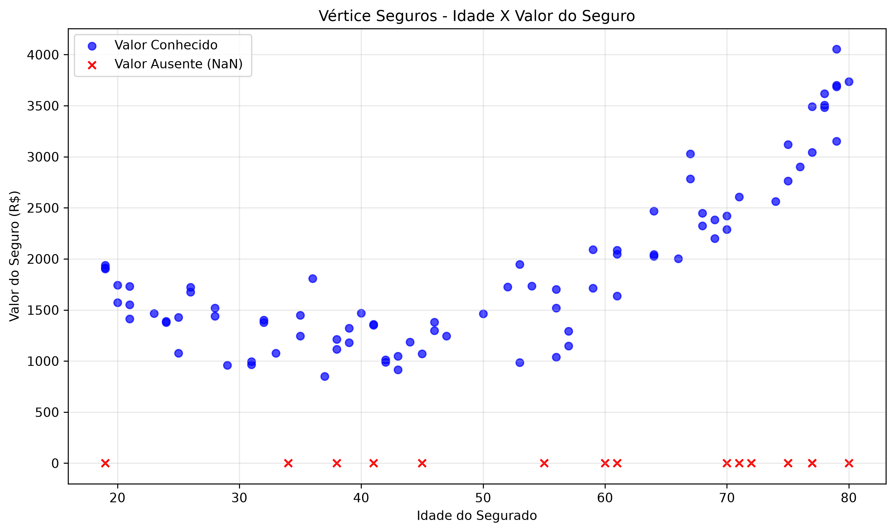
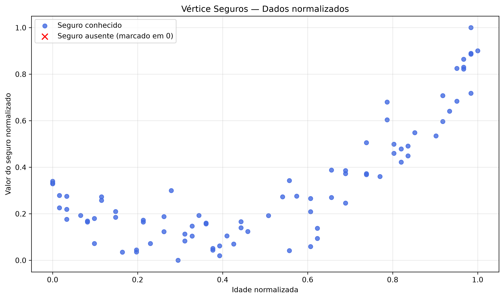
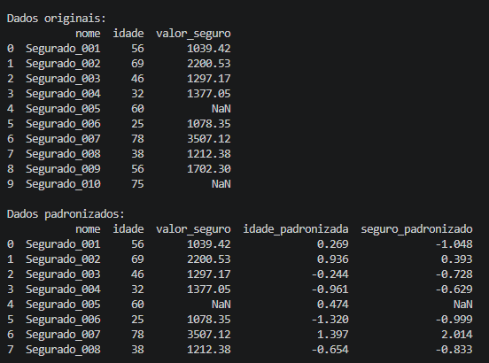
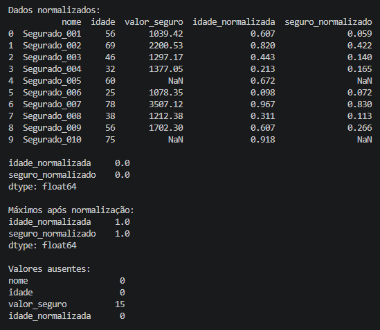

# Tratamento de Dados:

Diferentemente de um problema de classificação, no qual o modelo prevê categorias, a regressão busca estimar valores numéricos contínuos, como o preço de um seguro.

O *dataset* da Vértice Seguros possui a idade como variável de entrada (*feature*) e o valor do seguro como variável-alvo (*target*).

Os registros com valores de seguros conhecidos serão utilizados no treinamento e na avaliação do modelo. Os 15 registros com valores ausentes serão reservados para uma etapa posterior de previsão.

Antes do treinamento, são exploradas duas técnicas de transformação que podem ser encontradas na documentação técnica utilizando a biblioteca *Scikit-Learning*. 
Utilizado em *Python* focada em ciência de dados para aprendizado de máquina, uma de suas principais funcionalidades é o **Pré-Processamento** em que trata e normaliza os dados por meio de métodos e técnicas como: *StandardScaler*, *OneHotEncoder* ou *SimpleImputer*.

### Principais métodos de pré-processamentos de dados:

**Padronização**: centraliza os dados em torno da média e ajusta sua escala pelo desvio-padrão.

**Normalização**: reescala os valores para um intervalo definido, como 0 a 1.

### Análise de Dispersão entre variáveis:

O gráfico abaixo apresenta a relação entre a idade dos segurados e os valores do seguros em sua escala original.

E através de técnicas e ferramentas de *Machine Learning* temos abaixo um gráfico de dispersão e sua relação entre idade dos segurados com valores **Normalizados** para melhor resultado das previsões.

De qualquer forma, é importante verificar e manipular os dados com a biblioteca **Pandas** antes de realizar qualquer tipo de previsão.

Nesse caso específico, iremos usar os dados **normalizados** para deixar em conformidade com o modelo de *Deep Learning*. Os dados **padronizados** também podem ser usados para predição. Porém, os dados possuem um desvio padrão próximo de 1, contendo assim valores negativos. Já na **normalização** os valores são transformados em um faixa definida entre 0 a 1. 

> Obs: Para avaliação correta de um modelo, é muito importante o ajuste dos transformadores.
