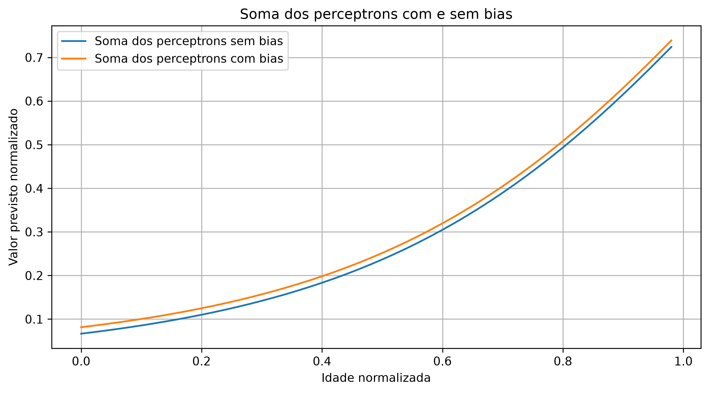
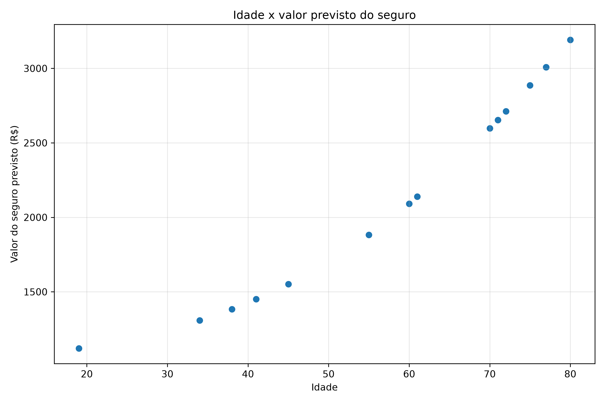
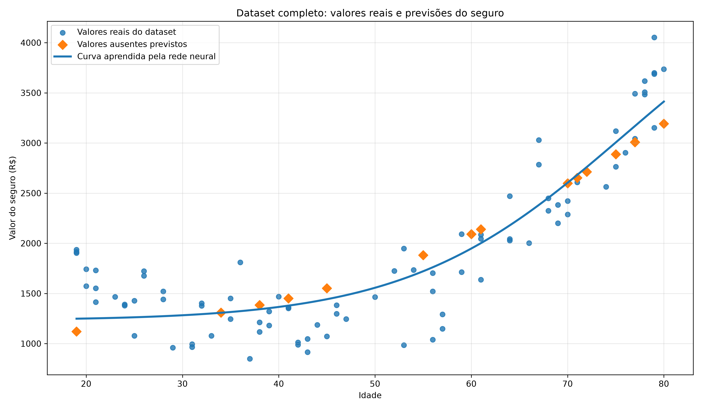

# Previsões:

A diferença entre as curvas será o valor constante de **bias_saida[0]**. A curva com bias representa a saída completa da rede, enquanto a curva sem bias mostra apenas a soma das contribuições dos dois perceptrons ocultos.

Como podemos verificar, a diferença é pequena:



Os pesos controlam como as entradas e ativações contribuem para a previsão. O bias oferece um ajuste adicional que permite posicionar melhor as transformações e a saída. No modelo, os dois trabalham em conjunto para estimar o valor normalizado do seguro com menor erro.

## Por que o bias é aprendido durante o treinamento?

```python
optimizer.zero_grad()
loss.backward()
optimizer.step()
```
* **loss.backward()** calcula os gradientes dos parâmetros, incluindo os biases.

* **optimizer.step()** atualiza os parâmetros para tentar reduzir a função de perda.

> Observação importante: Os biases da camada oculta continuam presentes nas ativações dos dois perceptrons.

*O bias oferece um parâmetro adicional para o modelo aprender a relação entre idade e valor do seguro. Isso pode melhorar o ajuste, mas não garante uma previsão melhor por si só: o resultado depende dos dados, do treinamento e da arquitetura.*

## Desnormalização e recuperação dos valores previstos:

Após o treinamento da rede neural, as previsões são geradas na escala normalizada, entre 0 e 1. Para recuperar a escala monetária original, utilizamos o método ```inverse_transform()``` da biblioteca **scikit-learn**, aplicando o mesmo **MinMaxScaler** ajustado com os valores de seguro conhecidos.

O ```inverse_transform()``` utiliza o mínimo e o máximo dos valores reais conhecidos para recuperar a escala monetária original.

```python
scaler_y = MinMaxScaler()
scaler_y.fit(valores_conhecidos)

previsoes_reais = scaler_y.inverse_transform(
    previsoes_normalizadas.reshape(-1, 1)
)
```
> **Observação**: Essa transformação permite converter as previsões normalizadas em valores monetários, facilitando sua interpretação e análise.

## Visualizações das previsões:

Com a biblioteca **matplotlib**, geramos um gráfico de dispersão que relaciona a idade aos valores de seguro previstos pelo modelo.

Dessa forma podemos obter os valores reais dos dados previstos:



Em seguida, integramos as previsões desnormalizadas ao dataset original, preservando os valores reais existentes e preenchendo os registros que apresentavam valores ausentes com as estimativas produzidas pela rede neural.

O gráfico abaixo apresenta o conjunto de dados completo, destacando os valores reais, as previsões dos registros incompletos e a curva de saída aprendida pelo modelo.



Essa visualização permite analisar conjuntamente os dados observados e estimados, além de observar o comportamento da rede neural ao longo da faixa de idades utilizada no projeto.

* **Observação técnica**: *a curva representa a saída combinada dos neurônios ocultos com ativação sigmoidal e da camada de saída linear. Portanto, seu formato não precisa corresponder a uma única curva sigmoidal perfeita.*