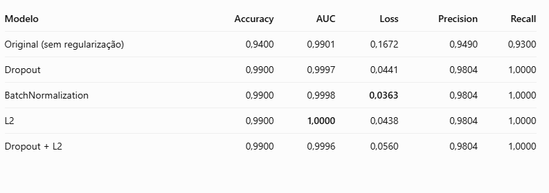
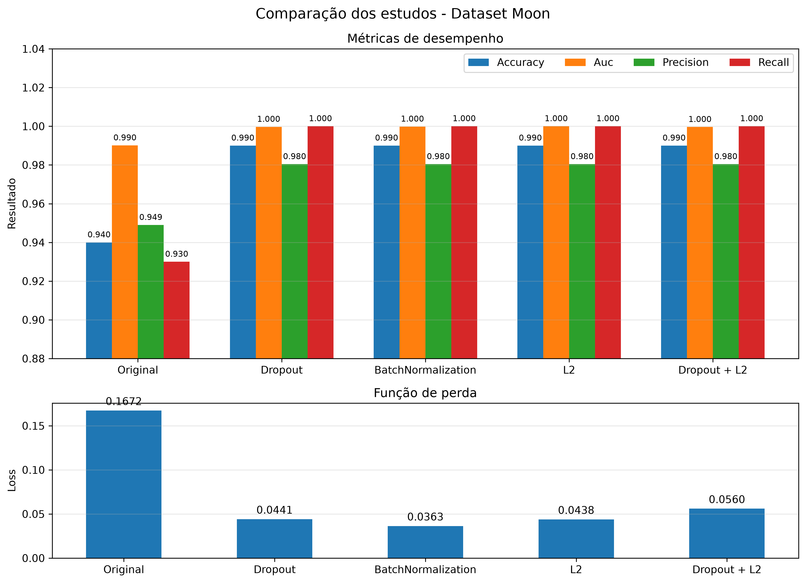
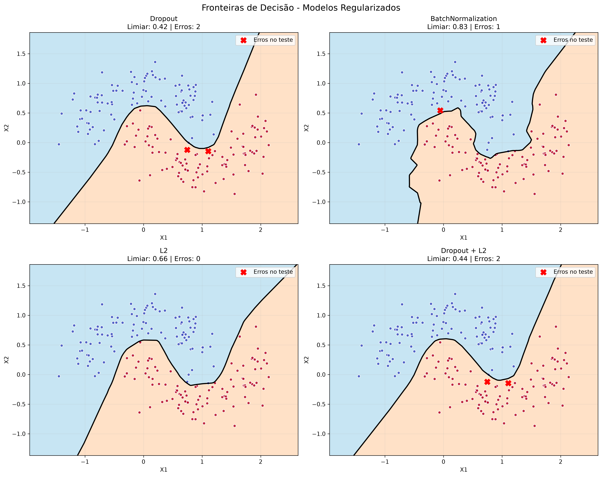

# Regularização (Regularization)

A regularização é um conjunto de técnicas utilizadas em Machine Learning e Deep Learning para reduzir o **overfitting (sobreajuste)**, situação em que o modelo aprende muito bem os padrões e particularidades dos dados de treinamento, mas apresenta dificuldades para generalizar esse aprendizado para novos dados.

O objetivo é evitar que a rede neural se torne excessivamente ajustada aos exemplos utilizados durante o treinamento, buscando um equilíbrio entre aprender os padrões relevantes e manter um bom desempenho diante de dados que ainda não foram apresentados ao modelo.

Nas redes neurais, algumas das principais técnicas de regularização são:

- **Dropout:** desativa aleatoriamente uma parte dos neurônios durante o treinamento, evitando que a rede dependa excessivamente de determinadas conexões.
- **BatchNormalization:** normaliza as ativações das camadas, ajudando a estabilizar e acelerar o processo de treinamento.
- **L2 (Weight Decay):** penaliza pesos elevados, incentivando a rede a manter parâmetros menores e reduzindo a complexidade do modelo.

> Neste experimento, essas técnicas serão aplicadas individualmente para observar seus efeitos no aprendizado, na prevenção do overfitting e na capacidade de generalização da rede neural MLP.

O parâmetro `regularizacao` permite selecionar qual técnica será aplicada às camadas ocultas da rede neural.

| Configuração | Comportamento |
|---|---|
| `regularizacao=None` | Não aplica nenhuma das três técnicas de regularização. |
| `regularizacao="dropout"` | Aplica Dropout após cada camada oculta. |
| `regularizacao="batch_normalization"` | Aplica BatchNormalization após cada camada oculta. |
| `regularizacao="l2"` | Aplica regularização L2 aos pesos das camadas ocultas. |

# Dropout

O Dropout é uma técnica que desativa aleatoriamente uma porcentagem de neurônios durante o treinamento da rede neural.

Por exemplo, utilizando `dropout_rate=0.2`, aproximadamente 20% dos neurônios da camada são temporariamente desativados durante cada atualização dos pesos. Isso ajuda a evitar que a rede neural dependa excessivamente de determinados neurônios, incentivando o aprendizado de padrões mais distribuídos.

No código:

```python
layers.Dropout(dropout_rate)(x)
```

Podemos experimentar diferentes taxas:

- `0.1`: desativa aproximadamente 10% dos neurônios.
- `0.2`: desativa aproximadamente 20% dos neurônios.
- `0.3`: desativa aproximadamente 30% dos neurônios.

> Uma taxa muito elevada pode dificultar o aprendizado, pois muitos neurônios deixam de participar simultaneamente do treinamento.

```python
===== EXPERIMENTO: Dropout =====
===== AVALIAÇÃO DO MODELO =====
accuracy: 0.9900
auc: 0.9997
loss: 0.0441
precision: 0.9804
recall: 1.0000
```

*O experimento com Dropout alcançou 99% de acurácia, AUC de 0,9997 e perda de 0,0441. A técnica apresentou excelente resultado, indicando que a desativação aleatória de neurônios durante o treinamento não prejudicou a capacidade de classificação do modelo.*

## BatchNormalization

BatchNormalization é uma técnica que normaliza as ativações recebidas de uma camada, utilizando estatísticas calculadas sobre os lotes (*batches*) de treinamento.

Essa normalização ajuda a estabilizar o processo de treinamento e pode facilitar a otimização da rede neural.

No código:

```python
layers.BatchNormalization()(x)
```
Assim temos:

```python
===== EXPERIMENTO: BatchNormalization =====
===== AVALIAÇÃO DO MODELO =====
accuracy: 0.9900
auc: 0.9998
loss: 0.0363
precision: 0.9804
recall: 1.0000
```

Diferentemente do Dropout, essa técnica não desativa neurônios. Ela ajusta a distribuição das ativações e utiliza parâmetros próprios que são aprendidos durante o treinamento.

O Batch Normalization apresentou a menor perda entre todos os experimentos, com 0,0363, além de 99% de acurácia e AUC de 0,9998. Esse resultado indica que, entre as configurações testadas, o modelo apresentou o menor erro de previsão no conjunto de teste. 

*Vale lembrar que Batch Normalization é principalmente uma técnica de normalização e estabilização das ativações, embora também possa contribuir para a regularização.*

## Regularização L2

A regularização L2 adiciona uma penalização à função de perda (*loss*), considerando a magnitude dos pesos da rede neural. Essa penalização incentiva o modelo a evitar pesos excessivamente elevados, ajudando a controlar sua complexidade e reduzindo o risco de overfitting.

No código:

```python
keras.regularizers.l2(l2_rate)
```

Estamos utilizando inicialmente:

```python
l2_rate=0.0001
```
```python
===== EXPERIMENTO: L2 =====
===== AVALIAÇÃO DO MODELO =====
accuracy: 0.9900
auc: 1.0000
loss: 0.0438
precision: 0.9804
recall: 1.0000
```

*O parâmetro `l2_rate` controla a intensidade da penalização. Quanto maior seu valor, maior será a influência da regularização sobre os pesos. Isso ajuda a evitar que a rede neural desenvolva pesos muito elevados e fique excessivamente ajustada aos dados de treinamento.*

A regularização L2 alcançou AUC de 1,0000, o melhor resultado entre os experimentos.
Isso indica uma capacidade de discriminação excepcional no conjunto avaliado. A técnica penaliza pesos elevados durante o treinamento, incentivando o modelo a aprender representações com pesos menos extremos. Apesar da AUC perfeita, a perda foi de 0,0438, ligeiramente superior à obtida com Batch Normalization.

## Considerações:

**Os resultados foram muito bons. As quatro técnicas de regularização alcançaram 99% de acurácia, superando os 94% do primeiro estudo. Entretanto, precisamos observar as diferenças entre as métricas e considerar que o novo experimento utiliza uma arquitetura diferente: (32, 16), enquanto o modelo original utilizava (16, 16).**

Em comparação com o primeiro estudo a acurácia passou de 94% para 99%. Nos quatro experimentos, o modelo classificou corretamente 198 das 200 amostras, deixando apenas duas classificações incorretas.

Também houve melhora expressiva na AUC e redução da perda em comparação com o primeiro estudo.



> Uma ressalva importante: não podemos atribuir toda essa evolução exclusivamente às técnicas de regularização. A arquitetura também mudou de (16, 16) para (32, 16). Portanto, os resultados demonstram a evolução das novas configurações, mas não isolam o efeito de cada técnica.



## Alteração do limiar de classificação (Threshold)

Além das técnicas de regularização, vamos investigar o efeito da alteração do limiar utilizado para converter as probabilidades previstas pela rede neural em classes.

Atualmente, utilizamos o valor `0.5`:

```python
y_pred = (y_pred_prob >= 0.5).astype(int)
```

A rede neural retorna probabilidades entre 0 e 1. O limiar determina a partir de qual probabilidade uma previsão será classificada como classe 1.




Após avaliar o efeito das técnicas de regularização e investigar diferentes limiares de classificação, podemos comparar os resultados para identificar qual configuração apresentou o melhor desempenho no Dataset Moon.

A regularização contribuiu para melhorar a capacidade de generalização dos modelos, enquanto o ajuste do limiar permitiu encontrar pontos de decisão mais adequados às probabilidades previstas por cada rede neural.

Esses resultados mostram que não existe um único limiar ideal para todas as arquiteturas. Cada modelo pode apresentar uma distribuição de probabilidades diferente, exigindo um ponto de decisão específico.

## Considerações finais

Neste estudo, foi possível observar três aspectos importantes:

1. Arquitetura da rede neural: a quantidade de camadas e neurônios influencia a capacidade de aprendizado do modelo.
2. Regularização: técnicas como Dropout, BatchNormalization e L2 modificam o processo de treinamento e podem contribuir para reduzir o overfitting.
3. Ajuste do limiar: permite modificar a classificação das observações sem precisar treinar novamente a rede neural.

> O experimento também evidencia a importância de analisar diferentes métricas, como Accuracy, Precision, Recall, F1-score e AUC, em vez de considerar somente a acurácia.

**Conclusão geral**: a combinação de uma arquitetura adequada, técnicas de regularização e um limiar de classificação bem selecionado pode proporcionar melhores resultados na classificação de dados não linearmente separáveis, como o Dataset Moon.