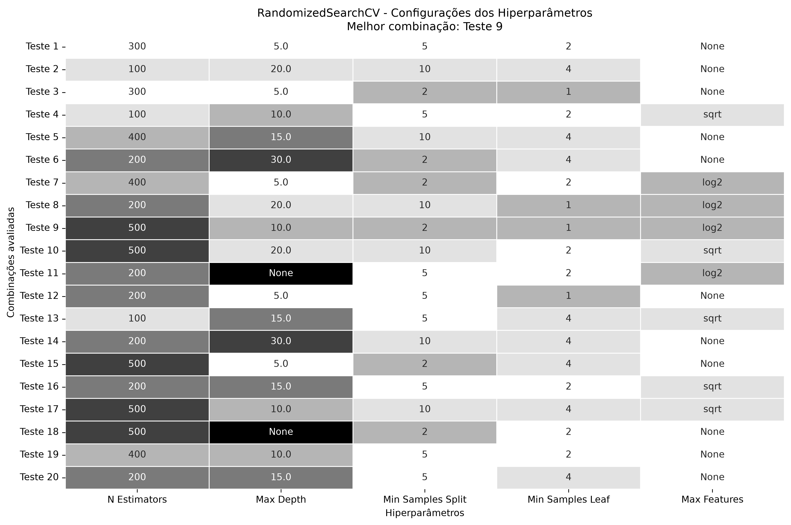

# Relatório de Otimização - RandomizedSearchCV

## Configuração da busca

- Modelo: Random Forest
- Método: RandomizedSearchCV
- Número de combinações: 20
- Validação cruzada: 5 folds
- Métrica de seleção: F1-macro
- Random state: 42

## Melhores hiperparâmetros

```python
{'n_estimators': 500, 'min_samples_split': 2, 'min_samples_leaf': 1, 'max_features': 'log2', 'max_depth': 10}
```


## Resultados

- Melhor F1-macro na validação cruzada: 0.9554
- Accuracy no conjunto de teste: 0.9561

## Matriz de confusão

```text
[[39  3]
 [ 2 70]]
```

## Métricas de classificação

```text
              precision    recall  f1-score    support
malignant      0.951220  0.928571  0.939759   42.00000
benign         0.958904  0.972222  0.965517   72.00000
accuracy       0.956140  0.956140  0.956140    0.95614
macro avg      0.955062  0.950397  0.952638  114.00000
weighted avg   0.956073  0.956140  0.956027  114.00000
```
## Integração com o fluxo MLOps

O `RandomizedSearchCV` representa uma etapa importante na evolução dos modelos desenvolvidos neste projeto.

Os artefatos gerados serão utilizados nas etapas seguintes:

- Comparação dos modelos baseline e otimizados.
- Registro de parâmetros, métricas e artefatos no MLflow Tracking.
- Seleção do modelo candidato para registro.
- Versionamento do modelo no MLflow Model Registry.
- Preparação do modelo para disponibilização por meio de uma API.

> Assim, a otimização passa a fazer parte de um fluxo estruturado, no qual treinamento, avaliação, persistência e documentação são tratados de maneira organizada e reproduzível.