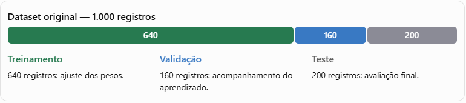
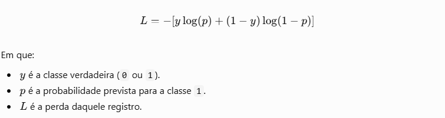
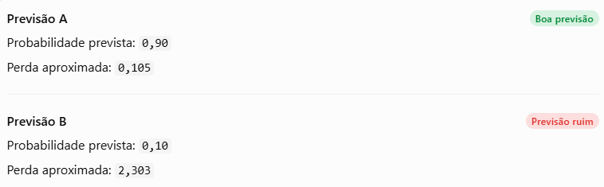
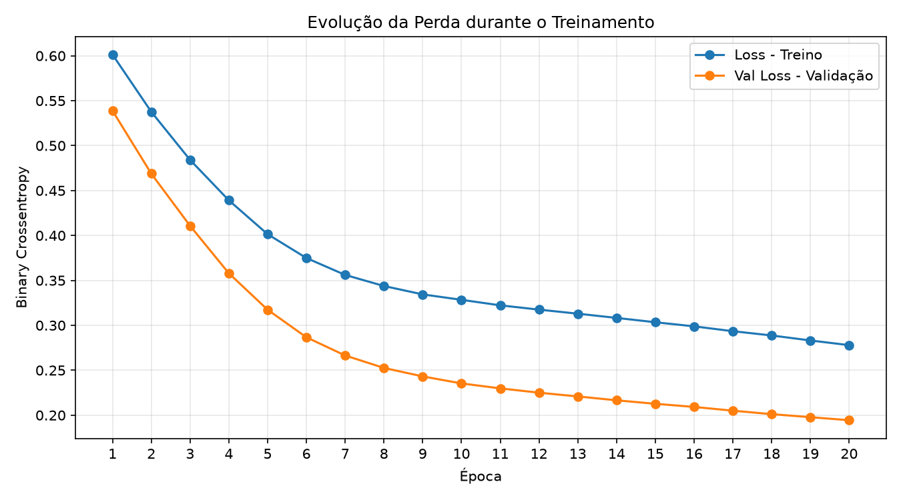
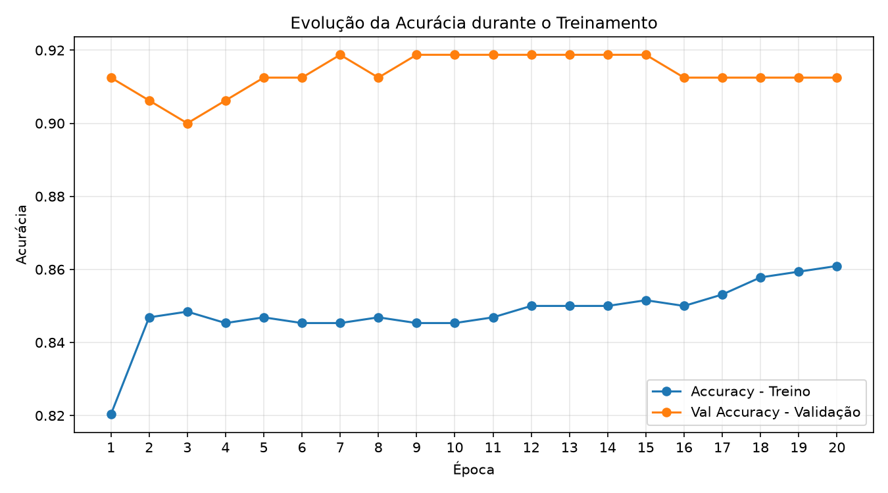

# Treinamento do Modelo

O treinamento de uma rede neural permite acompanhar seu processo de aprendizado e obter métricas que ajudam a avaliar seu desempenho. Essas informações são importantes para compreender como o modelo está aprendendo e se apresenta uma boa capacidade de generalização para dados que ainda não foram utilizados no treinamento.

A análise dos resultados permite identificar possíveis problemas, como o **overfitting**, fenômeno em que o modelo apresenta um bom desempenho nos dados de treinamento, mas tem dificuldade para prever corretamente novos dados e não somente exemplos de testes utilizados no aprendizado. 

No `overfitting` o modelo se ajusta demais aos exemplos de treinamento e pode errar ao classificar novos pontos. Quando isso ocorre, pode ser necessário ajustar o modelo para melhorar sua capacidade de generalização.

Dessa forma, os resultados obtidos durante o treinamento orientam as próximas etapas do desenvolvimento, auxiliando na decisão de manter a configuração atual ou realizar ajustes para alcançar um desempenho mais consistente.

O método `model.fit()` do Keras é utilizado para treinar a rede neural MLP (*Multilayer Perceptron*). O treinamento permite que o modelo ajuste seus pesos e aprenda os padrões presentes nos dados, relacionando as características de entrada (`X_train`) às classes correspondentes (`y_train`).

```python
hist = model.fit(
 -> X_train,  <-
 -> y_train,  <-
    validation_split=0.2,
    epochs=20,
    batch_size=32,
    verbose=0)
```

## Framework Keras:

O **Keras** acompanha o desempenho do modelo nos dados de treinamento e nos dados de validação a cada época. Você pode comparar:

- **accuracy e val_accuracy**: quanto o modelo acerta nos dois conjuntos.
- **loss e val_loss**: quanto o modelo erra segundo a função de perda nos dois conjuntos.

Uma observação importante: os dados de validação também são dados que o modelo não utiliza para atualizar seus pesos diretamente, mas seus resultados podem orientar ajustes no modelo. Já os dados de teste ficam reservados para a avaliação final.

> Em resumo, generalizar não significa prever qualquer dado com certeza. Significa aprender padrões que continuem funcionando em exemplos que o modelo ainda não encontrou.

O parâmetro `validation_split=0.2` reserva 20% dos dados de treinamento para validação, permitindo acompanhar o desempenho do modelo durante o aprendizado, sem utilizar esses registros para atualizar os pesos. Como o conjunto de treinamento possui 800 registros, são utilizados 640 para o treinamento e 160 para validação.



Esse parâmetro divide os 800 registros de treinamento. 

* **640 registros**: utilizados para atualizar os pesos da rede.
* **160 registros**: utilizados para validação durante as épocas.

**Observação:** os 200 registros separados anteriormente para teste (`X_test` e `y_test`) permanecem isolados durante essa etapa. Eles serão utilizados posteriormente para avaliar o desempenho do modelo em dados que não participaram do treinamento nem da validação.

### Lembra do Binary Crossentropy?

Durante a compilação do modelo é definido as principais configurações para criação de um modelo que a perda **'loss'** é declarada' como **'binary_crossentropy'.**

**Ela mede o erro das probabilidades prevista pelo modelo. Quanto menores os resultados, melhor para a função de perda.**

As previsões incorretas e feitas com muita confiança tenden a gerar uma perda maior.

Além disso temos um indicador derivado do *'loss'* -> *'val_loss'* que calcula a média das perdas dos registros validados durante cada época.

Portanto, a configuração **loss="binary_crossentropy"** informa ao Keras qual função utilizar para calcular a perda.

Essa função compara a probabilidade prevista com a classe verdadeira. Para uma classificação binária, sua fórmula é:



Vamos supor que um modelo está tentanto prever a verdadeira classe 1 em um exemplo de classificação binária:



Na **previsão A**, o modelo atribuiu 90% de probabilidade à classe correta. Na **previsão B**, atribuiu apenas 10%, favorecendo a classe errada. Por isso, a perda da previsão B é muito maior.

Quanto mais distante a probabilidade prevista estiver da resposta verdadeira, maior tende a ser a perda. Em particular, previsões muito confiantes e incorretas são penalizadas fortemente.

### Como o Keras calcula o 'val_loss'?

A cada época, o Keras utiliza os 160 registros de validação para fazer previsões e compara as probabilidades previstas com as classes verdadeiras.

O resultado é um valor que resume a perda nos dados de validação daquela época. Na prática, o Keras agrega as perdas de acordo com sua implementação e configuração; para o exemplo simples, pense nele como a média das perdas dos 160 registros.

O parâmetro `epochs=20` define a quantidade de épocas, ou seja, o número de passagens completas pelos dados utilizados no treinamento. 

Com isso temos como exemplo:

```python
Época 1:  val_loss = 0.578
Época 2:  val_loss = 0.485
Época 3:  val_loss = 0.453 <-
Época 4:  val_loss = 0.400
Época 5:  val_loss = 0.352
```

A menor perda seria **0.453**, na **época 3**. Depois disso, a perda diminuiu. Se esse aumento persistisse depois da **ÉPOCA 03** e a perda de treinamento continuasse diminuindo, poderia ser um sinal de **overfitting.**

### Binary Crossentropy x Epochs



No gráfico temos o exemplo de não **overfitting** e a menor perda ocorre na 20º época, tanto no treinamento quanto na validação:

- **Loss de treino**: aproximadamente 0,28
- **Val Loss de validação**: aproximadamente 0,198

A curva laranja **(validação)** apresenta a menor perda, chegando a aproximadamente **0,20** na 20ª época. Isso significa que, ao longo das épocas, o modelo foi diminuindo o erro ao comparar as probabilidades previstas com as classes reais, utilizando a função `**binary_crossentropy.**`

**Importante:** *como a perda de validação continua diminuindo até a última época, o gráfico não apresenta um sinal visual evidente de overfitting nesse intervalo. Isso não garante, por si só, que o modelo generalize bem para todos os dados novos.*

### A Acurácia do Modelo em Treino:



Nesse outro exemplo, a maior acurácia ocorre na validação, chegando a aproximadamento 0,913(91,3%) a partir da **13° época**, mantendo-se esse nível até a 20º época.

- **Acurácia de Treino (azul)**: aproximadamente 88,1% na 20º época.
- **Acurácia de validação (laranja)**: aproximadamente 91,3% da 13º à 20º época.

> **Observação importante:** A acurácia representa a proporção de previsões classificadas corretamente. Por exemplo, uma acurácia de 91,3% significa que, em média, cerca de 91 de cada 100 exemplos de validação foram classificados corretamente.

Observe que a acurácia de validação estabiliza na 13ª época, enquanto a de treino continua aumentando lentamente. Isso indica que o desempenho na validação deixou de melhorar de forma perceptível. Vale investigar se treinar por mais épocas traria algum benefício, embora esse gráfico, isoladamente, não comprove overfitting.

> *Relacionando com o gráfico de perda (binary_crossentropy): a acurácia mede quantas classificações estão corretas; a perda também considera o grau de confiança das probabilidades previstas. Por isso, a acurácia pode ficar estável enquanto a perda continua diminuindo.*


### Outros parâmetros:

Já `batch_size=32` determina que os exemplos sejam processados em lotes de até 32 registros antes de cada atualização dos pesos. Como temos 800 registros der treino e usamos ```validation_split=0.2```, ficam 640 registros para treinar e 160 para validar. Dessa forma são 640 registros por 32 lotes que ficam com 20 lotes por época. Cada lote de 20 unidades repesentam 32 registros.

Por fim, `verbose=0` desativa a exibição do progresso no terminal, enquanto a variável `hist` armazena o histórico do treinamento, incluindo as métricas de desempenho calculadas em cada época, tanto para os dados de treinamento quanto para os de validação.

# Componentes do treinamento:

| Componente | Explicação |
|---|---|
| `loss_test` | Armazena o valor da função de perda calculada durante a avaliação do modelo com os dados de teste. |
| `accuracy_test` | Armazena a acurácia do modelo nos dados de teste, indicando a proporção de previsões corretas. |
| `model.predict()` | Método do Keras que gera as previsões do modelo para os dados de entrada fornecidos. |
| `X_test` | Características do conjunto de teste, utilizadas para verificar como o modelo se comporta em dados que não participaram do treinamento. |
| `verbose=0` | Desativa a exibição do progresso durante a geração das previsões. |

---

